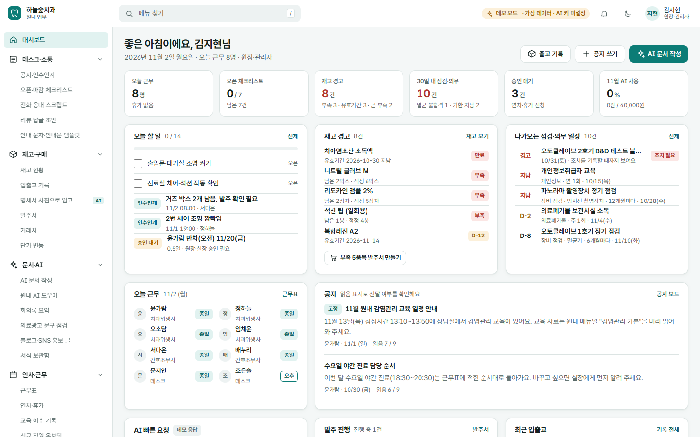
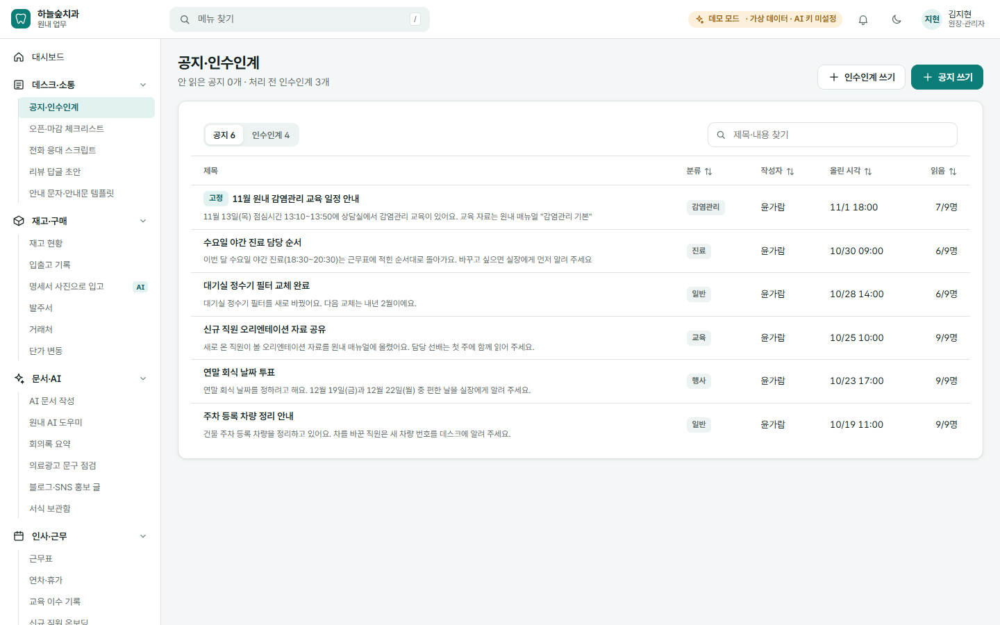
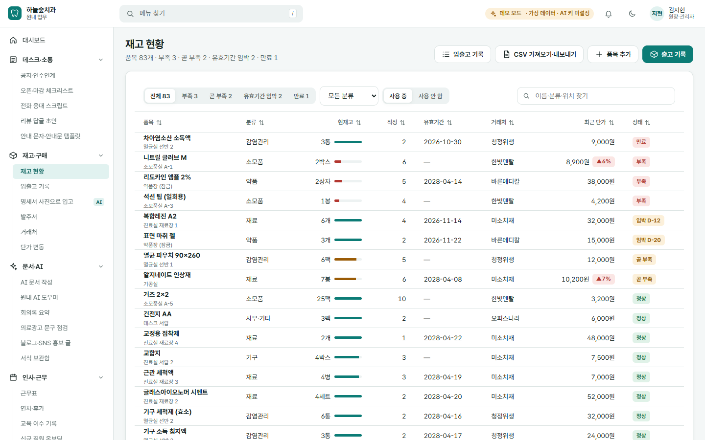
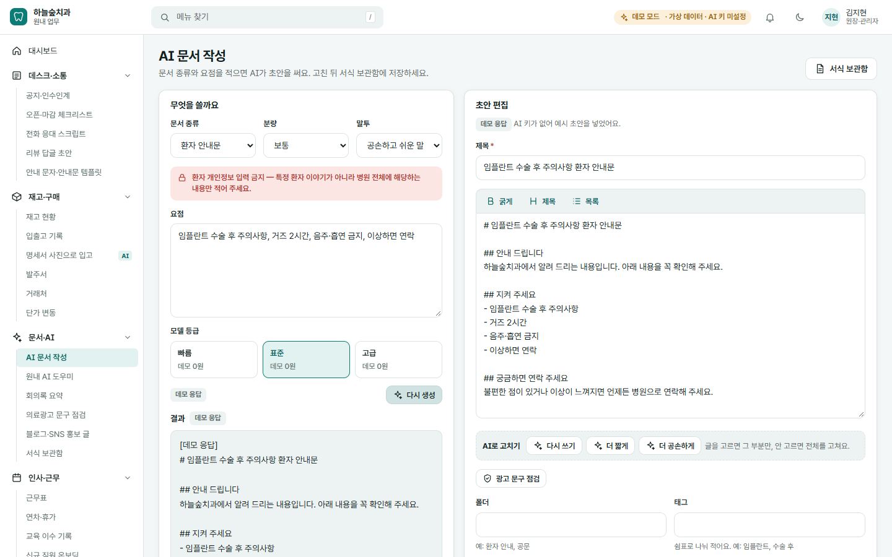
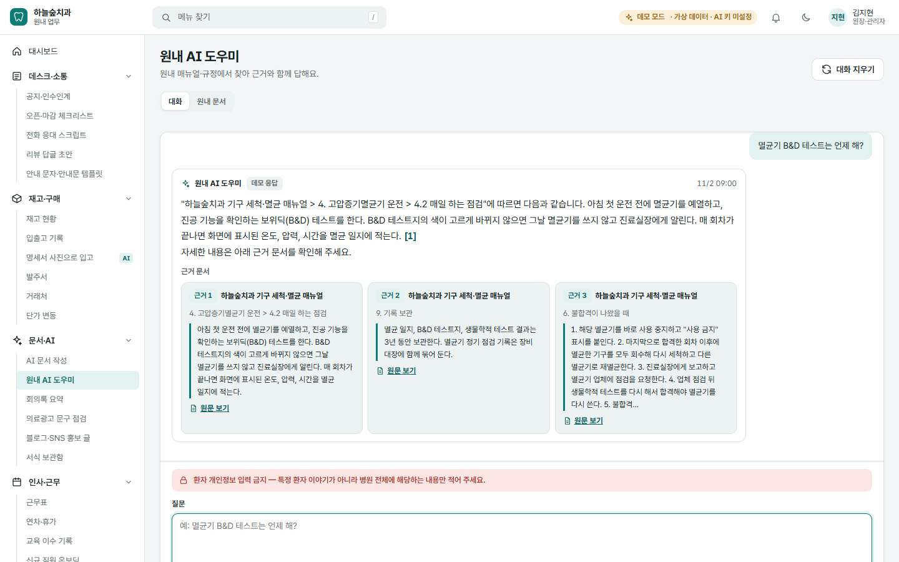
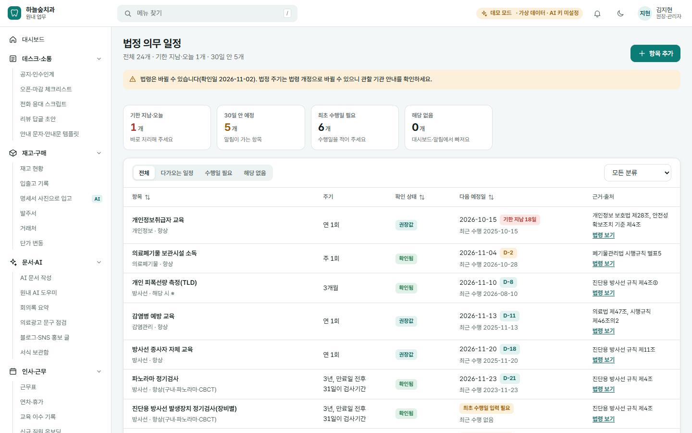
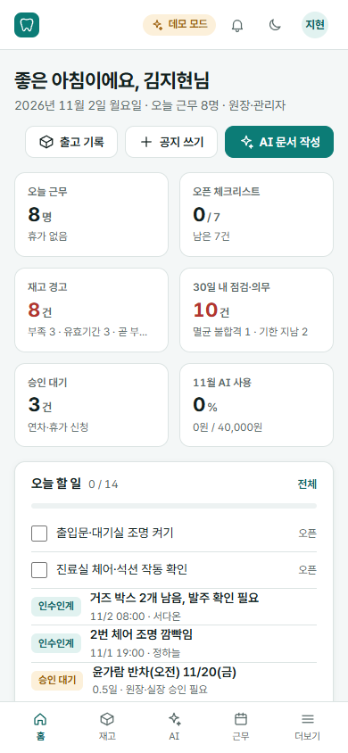
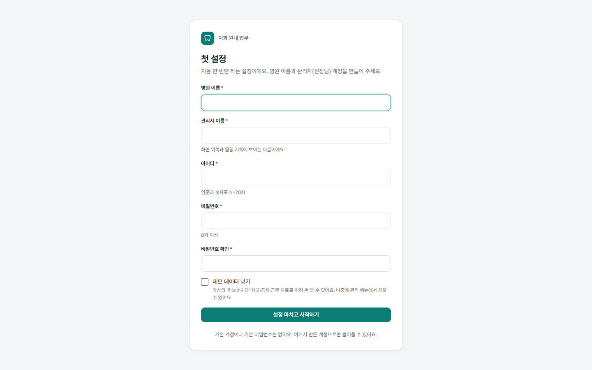
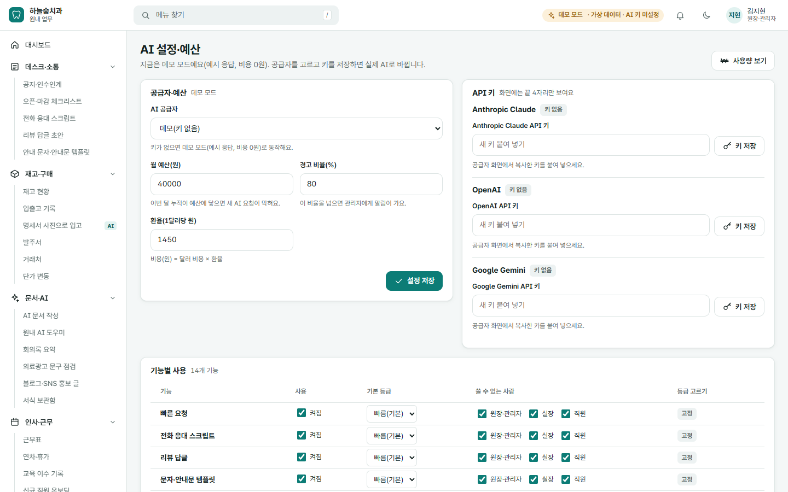
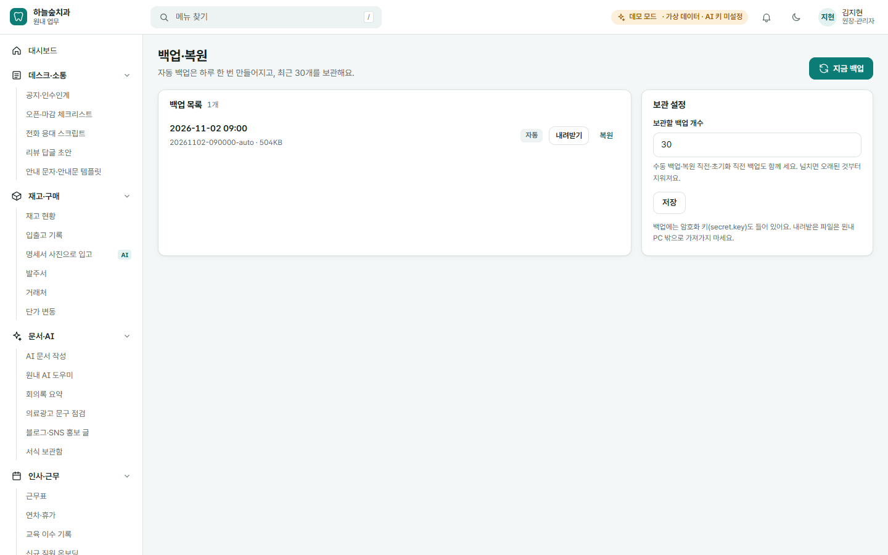

# 하늘숲치과 원내 업무 서비스

치과의 **진료 외 업무**(공지·인수인계, 재고·발주, 서류, 근무, 점검, 지출)를 한곳에 모은 원내 웹 서비스입니다.

- 원내 PC 한 대가 서버가 되고, 같은 와이파이·랜선에 연결된 PC·태블릿·휴대폰에서 인터넷 창으로 엽니다.
- **환자 정보는 저장하지 않습니다.** 환자 이름·연락처·주민번호·차트번호를 넣는 칸이 없습니다.
- AI 기능은 키가 없어도 **데모 모드**(예시 답, 비용 0원)로 모두 써 볼 수 있습니다.

> 이 문서는 코딩을 몰라도 따라 할 수 있게 썼습니다. 한 줄씩 차례대로 하시면 됩니다.
> 처음부터 끝까지 설치에 걸리는 시간은 약 20~30분입니다(인터넷 속도에 따라 다름).

---

## 할 수 있는 일

| 메뉴 | 할 수 있는 일 |
|---|---|
| 대시보드 | 오늘 할 일, 재고 경고, 다가오는 점검, 공지를 한 화면에서 봅니다 |
| 데스크·소통 | 공지·인수인계(읽음 확인), 오픈·마감 체크리스트, 전화 응대 스크립트, 리뷰 답글, 안내 문자 템플릿 |
| 재고·구매 | 재고 현황(적정 재고·유효기간 알림), 입출고 기록, 명세서 사진으로 입고, 발주서 자동 작성·인쇄, 거래처, 단가 변동, 엑셀(CSV) 가져오기·내보내기 |
| 문서·AI | AI 문서 작성(공문·안내문·규정·매뉴얼), 원내 AI 도우미(원내 매뉴얼에서 찾아 근거와 함께 답), 회의록 요약, 의료광고 문구 점검, 블로그·SNS 홍보 글, 서식 보관함 |
| 인사·근무 | 근무표, 연차·휴가 신청과 승인, 교육 이수 기록, 신규 직원 온보딩, 채용 공고·면접 질문 |
| 시설·법정 | 장비 점검·유지보수, 멸균기 점검 기록, 법정 의무 일정(방사선·교육·폐기물 등) |
| 운영 지표 | 지출 기록, 월간 요약 |
| 관리 | 사용자·권한, 병원 기본 정보, AI 설정·예산, AI 사용량·비용, 백업·복원, 활동 기록, 데모 데이터 초기화 |

아래 그림은 가상의 "하늘숲치과" 예시 데이터로 찍은 실제 화면입니다.

**대시보드** — 아침에 열면 오늘 할 일과 경고가 한눈에 보입니다.



**공지·인수인계** — 누가 읽었는지 확인할 수 있습니다.



**재고 현황** — 부족하거나 유효기간이 다가오는 품목이 위로 올라옵니다.



**AI 문서 작성** — 문서 종류와 요점만 적으면 초안을 써 줍니다(그림은 데모 응답).



**원내 AI 도우미** — 올려 둔 원내 매뉴얼에서 찾아, 근거 문서와 함께 답합니다.



**법정 의무 일정** — 기한이 다가오면 알림이 갑니다.



**휴대폰 화면** — 아래쪽 탭으로 자주 쓰는 메뉴에 바로 갑니다.



---

## 준비물

| 준비물 | 설명 |
|---|---|
| 서버로 쓸 Windows PC 1대 | Windows 10 또는 11. 진료 시간 동안 켜 둘 PC(데스크 PC 등). 메모리 4GB 이상, 빈 공간 2GB 이상 |
| 인터넷 연결 | **처음 설치할 때만** 필요합니다. 그 뒤로는 원내 네트워크만 있으면 됩니다(AI 기능을 실제로 쓸 때는 인터넷 필요) |
| 프로그램 폴더 | 이 README가 들어 있는 폴더 전체 |
| Node.js 24 LTS | 프로그램을 돌리는 무료 엔진입니다. 아래 설치 1단계에서 받습니다 |
| (선택) AI API 키 | 실제 AI를 쓰려면 필요합니다. 없으면 데모 모드로 동작합니다. 받는 방법은 [docs/LLM_GUIDE.md](docs/LLM_GUIDE.md) |

## 설치하기 (Windows)

**1단계. Node.js 24 LTS 설치하기**

1. 인터넷 창(Edge, Chrome)에서 **https://nodejs.org** 에 들어갑니다.
2. 초록색 **"LTS"** 표시가 붙은 버전(24로 시작하는 번호, 예: 24.13.0)의 **Windows 설치 파일(.msi)** 을 누릅니다.
3. 내려받은 파일을 더블클릭합니다.
4. 설치 창에서 **Next(다음)** 를 계속 누릅니다. 바꿀 것은 없습니다.
   - 중간에 "Tools for Native Modules"(추가 도구) 체크 칸이 나오면 **체크하지 않고** 넘어가도 됩니다.
5. **Finish(마침)** 를 누르면 끝입니다.

**2단계. 프로그램 폴더 놓기**

1. 받은 프로그램 폴더(또는 zip 파일)를 **`C:\clinic-ax`** 처럼 짧은 영문 경로에 둡니다.
   - zip 파일이면 오른쪽 클릭 → **"압축 풀기"** 를 먼저 합니다. zip 안에서 바로 실행하면 안 됩니다.
   - OneDrive(원드라이브)로 동기화되는 폴더(바탕 화면·문서 폴더가 동기화되는 경우)는 피하세요. 데이터 파일이 동기화 중에 잠길 수 있습니다.
2. 폴더 안에 `start.bat`, `stop.bat`, `README.md` 가 보이면 맞게 놓은 것입니다.

**3단계. 처음 실행하기**

1. 폴더에서 **`start.bat`** 을 더블클릭합니다.
2. 검은 창이 열리고 "필요한 파일을 내려받아요"가 나옵니다. **처음 한 번만** 몇 분 걸립니다(인터넷 필요).
3. 다 되면 창에 아래와 비슷한 안내가 나오고, 인터넷 창이 저절로 열립니다.

   ```
   ==================================================
     하늘숲치과 원내 업무 서버가 켜졌어요 (버전 0.1.0)
   ==================================================
     이 PC에서 열기:        http://localhost:8090
     원내 다른 기기(태블릿·휴대폰·다른 PC)에서 열기:
                            http://192.168.0.14:8090
   ```

4. 인터넷 창이 안 열리면 직접 **http://localhost:8090** 을 주소창에 적습니다.
5. **첫 설정** 화면이 보이면 설치 성공입니다. 이어서 아래 [첫 설정](#첫-설정)을 합니다.

> **검은 창은 닫지 마세요.** 이 창이 서버입니다. 닫으면 서버가 꺼집니다. 작업 표시줄로 내려 두면(최소화) 됩니다.

## 설치할 때 막히기 쉬운 곳

| 이렇게 보이면 | 이렇게 하세요 |
|---|---|
| 파란 창 **"Windows의 PC 보호"** 가 뜨고 실행이 안 됨 | **"추가 정보"** 를 누른 뒤 **"실행"** 을 누릅니다. 인터넷에서 받은 파일이라 Windows가 한 번 확인하는 것입니다 |
| `[문제] Node.js가 설치되어 있지 않아요` | 설치 1단계를 합니다. 설치한 뒤에는 **검은 창을 닫고** `start.bat` 을 다시 더블클릭합니다(이미 열린 창은 새 설치를 모릅니다) |
| `[문제] 설치된 Node.js 버전이 낮아요` | nodejs.org 에서 **24 LTS** 를 다시 설치합니다. 예전 버전 위에 그대로 설치해도 됩니다 |
| `[문제] 필요한 파일을 내려받지 못했어요` | 인터넷 연결을 확인하고 다시 실행합니다. 계속 안 되면 프로그램 폴더 안 `node_modules` 폴더를 지우고 다시 실행합니다 |
| 포트(8090)를 쓸 수 없다는 안내 | 서버가 이미 켜져 있을 수 있습니다. 작업 표시줄에 다른 검은 창이 있는지 봅니다. 다른 프로그램이 8090을 쓰고 있으면 [문제 해결](#문제-해결)의 "포트 바꾸기"를 봅니다 |
| **"Windows 보안 경고"** (방화벽) 창이 뜸 | **"개인 네트워크"만 체크**하고 **"액세스 허용"** 을 누릅니다. 자세한 내용은 [Windows 방화벽 허용](#windows-방화벽-허용) |
| 글자가 깨져 보임 | `start.bat` 을 직접 더블클릭해서 실행하세요. 다른 명령 창 안에서 실행하면 글자가 깨질 수 있습니다 |

## 매일 켜고 끄기

**켜기**

1. 아침에 서버 PC를 켭니다.
2. 프로그램 폴더의 **`start.bat`** 을 더블클릭합니다. (둘째 날부터는 몇 초면 켜집니다)
3. 검은 창은 **최소화**해 두고, 인터넷 창에서 씁니다.

**끄기** (둘 중 하나)

- 프로그램 폴더의 **`stop.bat`** 을 더블클릭합니다. (권장: 안전하게 끕니다)
- 또는 검은 창의 **X** 를 눌러 닫습니다.

**편하게 쓰는 요령**

- **바탕 화면 바로 가기**: `start.bat` 을 오른쪽 클릭 → "바로 가기 만들기" → 만들어진 바로 가기를 바탕 화면으로 옮깁니다.
- **PC를 켜면 저절로 켜기**: `Windows 키 + R` → `shell:startup` 입력 → 확인 → 열린 폴더에 위 바로 가기를 넣습니다.
- 서버가 갑자기 멈추면 검은 창이 5초 뒤 스스로 다시 켭니다(최대 5번).
- 서버 PC가 **절전 모드**로 들어가면 다른 기기에서 접속이 끊깁니다. 진료 시간에는 절전되지 않게 설정해 두세요(설정 → 시스템 → 전원).

## 직원 PC·태블릿·휴대폰에서 접속하기

**1. 서버 주소 찾기**

- `start.bat` 의 검은 창에 **"원내 다른 기기에서 열기"** 아래 나온 주소가 서버 주소입니다. 예: `http://192.168.0.14:8090`
- 검은 창을 놓쳤다면: 서버 PC에서 `Windows 키 + R` → `cmd` → 확인 → `ipconfig` 입력 → **"IPv4 주소"** 의 숫자(예: 192.168.0.14)를 찾아 `http://그 숫자:8090` 으로 씁니다.
- 주소가 여러 개 나오면 `192.168.` 로 시작하는 것을 먼저 써 봅니다.

**2. 다른 기기에서 열기**

1. 그 기기가 **서버 PC와 같은 와이파이(또는 같은 공유기 랜선)** 에 연결됐는지 확인합니다. 손님용 와이파이는 안 됩니다.
2. 인터넷 창 주소창에 서버 주소(예: `http://192.168.0.14:8090`)를 적습니다. 앞의 **`http://`** 까지 적어야 합니다(https 아님).
3. 로그인 화면이 나오면 성공입니다. 자주 쓰는 기기는 **즐겨찾기**에 넣어 두세요.

**3. 휴대폰 홈 화면에 앱처럼 추가하기**

- 아이폰(Safari): 주소를 연 뒤 아래 **공유 버튼** → **"홈 화면에 추가"**
- 안드로이드(Chrome): 주소를 연 뒤 오른쪽 위 **⋮** → **"홈 화면에 추가"**

> 서버 주소(숫자)가 가끔 바뀌면 즐겨찾기가 안 열립니다. 공유기 설정의 **"DHCP 고정 할당(IP 예약)"** 으로 서버 PC 주소를 고정하면 편합니다. 공유기 설정이 어렵다면 공유기 설치 업체에 "이 PC의 IP를 고정해 달라"고 요청하세요.

### Windows 방화벽 허용

다른 기기에서 열리지 않으면, 대개 서버 PC의 방화벽이 막고 있는 것입니다.

**처음 실행할 때 "Windows 보안 경고" 창이 뜨면**

1. **"개인 네트워크"** 에만 체크합니다.
2. **"공용 네트워크"는 체크하지 않습니다.**
3. **"액세스 허용"** 을 누릅니다.

**창을 놓쳤거나 "취소"를 눌렀다면**

1. 시작 메뉴에서 **"Windows 보안"** 을 엽니다.
2. **"방화벽 및 네트워크 보호"** → **"방화벽에서 앱 허용"** 을 누릅니다.
3. **"설정 변경"** 을 누르고, 목록에서 **"Node.js JavaScript Runtime"** 을 찾습니다.
4. 그 줄의 **"개인"** 칸에 체크합니다("공용"은 체크하지 않음). **확인**을 누릅니다.
5. 목록에 없으면 **"다른 앱 허용"** → **찾아보기** → `C:\Program Files\nodejs\node.exe` 를 고릅니다.

**그래도 안 되면** 서버 PC의 네트워크가 "공용"으로 되어 있을 수 있습니다.

- 설정 → **네트워크 및 인터넷** → 연결된 와이파이(또는 이더넷) → **"네트워크 프로필 유형"** 을 **"개인 네트워크"** 로 바꿉니다.

## 첫 설정

설치하고 처음 열면 **첫 설정** 화면이 나옵니다. 이 화면은 계정이 하나도 없을 때만 나옵니다.



### 관리자 계정 만들기

1. **병원 이름**, **관리자 이름**(원장님 성함), **아이디**, **비밀번호**를 적습니다.
   - 기본 비밀번호는 없습니다. 직접 정한 비밀번호를 꼭 기억하세요.
2. **"데모 데이터 넣기"** 를 켜면 가상 "하늘숲치과" 예시 데이터가 들어갑니다. 먼저 둘러보고 싶을 때 켭니다.
   - 실제로 쓰기 시작할 때는 **관리 → 데모 데이터 초기화**에서 지울 수 있습니다.
3. 완료를 누르면 로그인 상태로 대시보드가 열립니다.

> 원장·관리자 계정을 **2개** 만들어 두기를 권합니다(예: 원장님, 실장님 중 한 명). 한 사람이 비밀번호를 잊었을 때 다른 관리자가 초기화해 줄 수 있습니다.

### 직원 추가하기

1. 왼쪽 메뉴 **관리 → 사용자·권한** 을 엽니다.
2. **"직원 추가"** 를 누릅니다.
3. **이름, 아이디, 역할, 직무, 입사일**을 적습니다. (이 다섯 가지만 받습니다)
   - 역할은 3단계입니다: **원장·관리자**(모든 기능) / **실장**(승인·재고·발주 등) / **직원**(기본 업무)
4. **"추가하고 임시 비밀번호 받기"** 를 누릅니다.
5. 화면에 나온 **임시 비밀번호**를 직원에게 알려 줍니다. (이 화면을 닫으면 다시 볼 수 없습니다)
6. 직원은 처음 로그인할 때 자기 비밀번호로 바꿉니다.

직원이 비밀번호를 잊으면 같은 화면에서 그 직원의 **비밀번호 초기화**를 눌러 새 임시 비밀번호를 줍니다.

### AI 키 넣기

키가 없으면 모든 AI 기능이 **데모 모드**(예시 답, 비용 0원)로 동작합니다. 실제 AI를 쓰려면:

1. 공급자(Anthropic, OpenAI, Google 중 하나)에서 API 키를 받습니다. → [docs/LLM_GUIDE.md](docs/LLM_GUIDE.md)
2. 왼쪽 메뉴 **관리 → AI 설정·예산** 을 엽니다.
3. 오른쪽 **API 키** 칸에서 받은 공급자 칸에 키를 붙여 넣고 **"키 저장"** 을 누릅니다.
4. 왼쪽 **AI 공급자** 에서 그 공급자를 고르고, **월 예산(원)** 을 정한 뒤 **"설정 저장"** 을 누릅니다.
5. 아래 **"AI 시험해 보기"** 로 연결을 확인합니다.



- 키는 이 서버 PC에 **암호화해 저장**되고, 화면에는 끝 4자리만 보입니다.
- 이번 달 사용 금액이 예산의 **80%** 를 넘으면 관리자에게 알림이 가고, **100%** 가 되면 새 AI 요청이 막힙니다. 예산을 올리면 바로 풀립니다.
- 어느 공급자가 얼마나 드는지는 [docs/COST.md](docs/COST.md)를 보세요. 직원 5~20명 기준 보통 **한 달 몇천 원** 수준입니다.

## 백업과 복원

**자동 백업** — 서버가 켜져 있으면 **하루 한 번** 저절로 백업합니다. 따로 할 일은 없습니다.

**백업 화면** — 왼쪽 메뉴 **관리 → 백업·복원**



- **지금 백업**: 큰 작업(데이터 정리, 업데이트) 전에 누릅니다.
- **내려받기**: 백업을 zip 파일로 받아 USB 등에 따로 보관합니다.
- **보관할 백업 개수**: 오래된 백업은 이 개수를 넘으면 저절로 지워집니다.

**복원하기**

1. **관리 → 백업·복원** 에서 되돌리고 싶은 날짜의 백업 옆 **"복원하기"** 를 누릅니다.
2. 확인 창에서 한 번 더 확인합니다.
3. 지금 상태는 "복원 직전" 백업으로 따로 남습니다(되돌리기 가능).
4. 복원하는 동안 다른 직원은 잠시 쓸 수 없고, 끝나면 모두 다시 로그인합니다.

**PC를 바꾸거나 고장 대비로 통째로 복사하기**

1. `stop.bat` 으로 서버를 끕니다.
2. 프로그램 폴더 안 **`data`** 폴더와 **`backups`** 폴더를 USB 등에 복사합니다.
3. 새 PC에서는 설치 1~2단계를 한 뒤, 복사해 둔 `data` 폴더를 프로그램 폴더에 넣고 `start.bat` 을 실행합니다.

> 백업에는 API 키를 푸는 열쇠(`secret.key`)도 들어 있습니다. 백업 파일을 밖으로 가져갈 때는 잠긴 곳에 보관하세요.

## 업데이트

새 버전 프로그램 폴더(또는 zip)를 받았을 때:

1. **관리 → 백업·복원** 에서 **"지금 백업"** 을 누릅니다.
2. `stop.bat` 으로 서버를 끕니다.
3. 지금 프로그램 폴더의 **`data`** 와 **`backups`** 폴더를 다른 곳(예: 바탕 화면)에 **복사**해 둡니다(안전용).
4. 새 버전 파일을 프로그램 폴더에 **덮어씁니다.** 이때 `data`, `backups` 폴더는 지우지 않습니다.
5. `start.bat` 을 실행합니다. 프로그램이 바뀐 것을 알아채고 필요한 파일을 다시 내려받습니다(인터넷 필요, 몇 분).
6. 로그인해서 데이터가 그대로 있는지 확인합니다. 문제가 있으면 3번에서 복사해 둔 `data` 폴더를 되돌려 놓습니다.

## 보안·주의 (외부 공개 위험)

아래 내용은 보안 점검 결과(docs/SECURITY.md 5절)에서 옮겨 왔습니다. 꼭 지켜 주세요.

- **이 프로그램은 병원 안 네트워크 전용입니다.** 원내 와이파이·유선망 밖(인터넷)에서 오는 접속은 서버가 막습니다(403). 공유기의 "포트 포워딩"이나 "DMZ"로 8090 포트를 인터넷에 열지 마세요.
- **`data/config.json`의 `allowExternal: true`는 켜지 마세요.** 켜면 원내망 제한이 꺼져 인터넷 어디서나 로그인 화면에 닿을 수 있습니다. 이 프로그램은 http(암호화 없음)라서 외부에 열면 비밀번호와 업무 내용이 그대로 지나갑니다. 원외 접속이 꼭 필요하면 병원 VPN을 먼저 설치하고, VPN 안에서만 접속하세요.
- **연결은 암호화되지 않습니다(http).** 같은 원내망 안에서 다른 사람이 통신을 엿볼 수 있으므로, 병원 와이파이에는 강한 비밀번호(WPA2/WPA3)를 걸고 손님용 와이파이와 나누세요. (사용자 결정 TD-017: http 유지)
- **백업 폴더에는 API 키를 푸는 열쇠(`secret.key`)도 들어 있습니다.** 다른 PC로 복원해도 키를 다시 넣지 않게 하기 위해서입니다. 백업 폴더나 내려받은 zip을 USB·메일·클라우드로 원내 밖에 옮길 때는 잠긴 곳에 보관하세요. 잃어버렸다면 관리 화면에서 AI 키를 바로 바꾸세요(공급자 사이트에서 옛 키 삭제).
- **서버 PC의 `data` 폴더 자체가 모든 기록입니다.** 서버 PC에는 Windows 로그인 비밀번호를 걸고, 직원 공용 계정으로 쓰지 마세요. 파일을 직접 고치는 것은 프로그램이 막을 수 없습니다(감사 로그 변경 금지는 프로그램 안에서만 지켜집니다).
- **사진 속 개인정보는 자동으로 가려지지 않습니다.** 명세서 사진을 AI로 읽을 때 글자 필터는 사진 속 글을 검사할 수 없습니다. 환자 이름·연락처가 찍힌 종이는 찍지 마세요.
- **환자 개인정보는 어디에도 입력하지 마세요.** AI 입력은 주민번호·카드번호를 막고 전화번호·이메일을 가리지만, 이름처럼 규칙으로 알아볼 수 없는 정보는 걸러지지 않습니다.
- **처음 실행할 때 Windows 방화벽 허용 창**이 뜨면 "개인 네트워크"만 허용하세요("공용 네트워크"는 허용하지 않기).
- **업데이트**: 새 판을 받을 때는 `npm audit --omit=dev`로 high·critical 취약점이 0인지 확인하는 것이 좋습니다(개발 PC에서).

**http라서 생기는 작은 제약(TD-017)**

- 주소가 `https`가 아니라 `http`라서, 인터넷 창이 주소창에 **"주의 요함"** 을 표시할 수 있습니다. 원내 전용이라 정상입니다.
- 휴대폰 "홈 화면에 추가"는 되지만, 인터넷이 끊긴 상태에서 열리는 기능(오프라인 앱)은 없습니다. 서버에 연결이 안 되면 화면 위에 **"원내 와이파이 연결 확인"** 띠가 나옵니다.

## 자주 묻는 질문 (FAQ)

**Q. AI 키가 없어도 쓸 수 있나요?**
네. 키가 없으면 AI 기능이 예시 답(데모 응답)을 보여 주고, 나머지 기능(재고, 공지, 근무표 등)은 모두 그대로 씁니다. 비용은 0원입니다.

**Q. AI 비용은 얼마나 드나요?**
직원 5명 병원에서 보통 한 달 1천~2천 원, 20명이어도 4천~8천 원 정도로 계산됩니다(사용 횟수 가정 포함). 자세한 계산은 [docs/COST.md](docs/COST.md)에 있습니다. 실제 금액은 **관리 → AI 사용량·비용** 에서 매일 확인할 수 있습니다.

**Q. AI에 보낸 내용이 학습에 쓰이나요?**
세 공급자 모두 **유료 API는 기본적으로 학습에 쓰지 않는다**고 밝힙니다. 단, Google은 **무료 등급**이면 학습·사람 검토에 쓸 수 있으니 결제(유료 등급)를 연결해서 쓰세요. 공급자별 보관 기간은 [docs/COST.md](docs/COST.md)의 "공급자별 데이터 정책"에 있습니다.

**Q. 환자 이름을 넣으면 어떻게 되나요?**
넣지 마세요. 이 프로그램에는 환자 정보 칸이 없습니다. AI 입력의 주민번호·카드번호는 막히고 전화번호·이메일은 가려지지만, 이름은 자동으로 알아보지 못합니다.

**Q. 인터넷이 끊기면요?**
원내 네트워크(공유기)만 살아 있으면 AI를 뺀 모든 기능이 됩니다. AI는 인터넷이 돌아오면 다시 됩니다.

**Q. 서버 PC를 꺼도 되나요?**
꺼도 데이터는 안전합니다. 다만 꺼져 있는 동안에는 아무도 접속할 수 없고, 하루 한 번 자동 백업은 서버가 켜져 있을 때 만들어집니다.

**Q. 원장(관리자) 비밀번호를 잊었어요.**
다른 원장·관리자 계정이 있으면 **관리 → 사용자·권한** 에서 초기화해 줄 수 있습니다. 관리자 계정이 하나뿐이면 프로그램 안에서 되찾을 방법이 없습니다. 아래 [Claude Code로 고쳐 달라고 할 때](#claude-code로-고쳐-달라고-할-때)처럼 도움을 받아야 하니, 관리자 계정을 2개 만들어 두세요.

**Q. 처음에 넣은 데모 데이터를 지우고 싶어요.**
**관리 → 데모 데이터 초기화** 에서 확인 문구를 적고 초기화합니다. 지우기 직전 상태는 백업으로 남습니다.

**Q. 엑셀 재고표를 옮길 수 있나요?**
네. **재고·구매 → 재고 현황** 위쪽의 **"CSV 가져오기·내보내기"** 에서 양식을 받아, 엑셀에서 붙여 넣고 저장한 뒤 올립니다.

**Q. 한글(HWP) 파일을 올릴 수 있나요?**
서식 보관함에는 보관용으로 올릴 수 있습니다. 원내 AI 도우미가 읽을 수 있는 파일은 txt·md·pdf·docx입니다. 한글 파일은 "다른 이름으로 저장"에서 PDF나 DOCX로 바꿔 올리세요.

## 문제 해결

| 증상 | 확인할 것 |
|---|---|
| 다른 기기에서 안 열림 | ① 서버 PC의 검은 창이 켜져 있나 ② 같은 와이파이인가(손님용 아님) ③ 주소 앞에 `http://` 를 적었나 ④ [Windows 방화벽 허용](#windows-방화벽-허용) ⑤ 서버 주소(숫자)가 바뀌지 않았나 |
| 이 PC에서도 안 열림 | 검은 창이 꺼졌을 수 있습니다. `start.bat` 을 다시 실행합니다 |
| 화면 위에 "원내 와이파이 연결 확인" 띠 | 서버가 꺼졌거나 와이파이가 끊겼습니다. 서버 PC를 확인합니다 |
| "서버가 5번 다시 시작했지만 계속 멈췄어요" | PC를 다시 시작한 뒤 실행합니다. 그래도 같으면 `data\logs\server.log` 파일을 Claude Code에 보여 주고 원인을 물어봅니다 |
| 포트 바꾸기(8090을 다른 프로그램이 씀) | 프로그램 폴더의 `data\config.json` 파일을 메모장으로 열어 `{"port": 8091}` 처럼 적고 저장한 뒤 `start.bat` 을 다시 실행합니다. 주소의 `:8090` 도 `:8091` 로 바꿔 씁니다 |
| "AI 키가 올바르지 않거나 만료되었습니다" | 키가 틀렸거나 공급자 사이트에서 지워졌습니다. 새 키를 받아 **관리 → AI 설정·예산** 에 다시 넣습니다. 공급자 사이트의 결제(크레딧)가 남아 있는지도 확인합니다 |
| "이번 달 AI 예산을 모두 사용했습니다" | **관리 → AI 설정·예산** 에서 월 예산을 올립니다. 올리면 바로 풀립니다 |
| "AI 서비스 요청이 많아 잠시 막혔습니다" / "AI 응답이 너무 오래 걸려 중단했습니다" | 공급자 쪽이 붐비거나 글이 깁니다. 1분 뒤 다시 하거나 내용을 줄입니다 |
| "인터넷 연결을 확인해 주세요" (AI) | 서버 PC가 인터넷에 연결되어 있어야 AI를 쓸 수 있습니다. AI 말고 다른 기능은 그대로 됩니다 |
| "로그인을 5번 실패해 15분 동안 잠겼습니다" | 비밀번호를 5번 틀리면 15분 동안 잠깁니다. 15분 뒤 다시 하거나 관리자에게 비밀번호 초기화를 부탁합니다 |
| 오래 안 쓰면 로그아웃됨 | 8시간 동안 아무것도 안 하면 안전을 위해 로그아웃됩니다. 다시 로그인하면 됩니다 |

**기록(로그) 보는 곳**: 프로그램 폴더의 `data\logs\server.log` (키·비밀번호는 기록하지 않습니다)

## 폴더 지도

"이 기능을 고치려면 어느 파일을 보면 되나"를 정리한 표입니다. Claude Code에 수정을 부탁할 때 이 경로를 함께 알려 주면 빠릅니다.

| 폴더·파일 | 들어 있는 것 |
|---|---|
| `start.bat`, `stop.bat` | 서버 켜기·끄기(실제 순서는 `scripts\windows\start-main.cmd`, `stop-main.cmd`) |
| `data\` | **실제 데이터**(DB `app.db`, 올린 파일, 설정 `config.json`, 기록 `logs\`). git에 올리지 않습니다 |
| `backups\` | 자동·수동 백업 |
| `server\main.ts` | 서버 시작, 시작 안내 문구 |
| `server\modules\<기능>\` | 기능별 서버 처리(아래 표) |
| `server\ai\` | AI 연결(공급자별 `providers\`), 비용 계산 `pricing.ts`, 예산 `budget.ts` |
| `server\ai\features\<기능>.ts` | AI 기능 14개의 **프롬프트(AI에게 주는 지시문)** 와 데모 답 |
| `server\privacy\` | AI로 보내기 전 개인정보 검사(전화번호·주민번호 등) |
| `server\db\migrations\` | DB 표 구조 |
| `shared\` | 서버·화면이 함께 쓰는 규칙(역할 권한 `roles.ts`, AI 기능 목록 `ai-features.ts`) |
| `web\src\pages\<기능>\` | 기능별 **화면** |
| `web\src\lib\nav.ts` | 왼쪽 메뉴 이름과 순서 |
| `web\src\styles\` | 색·글꼴·간격 |
| `tests\` | 자동 검사(브라우저 검사는 `tests\e2e\`) |
| `docs\` | 설계·결정·보안·비용 문서 |

| 기능 | 서버 | 화면 |
|---|---|---|
| 공지·체크리스트·스크립트·템플릿 | `server\modules\desk\` | `web\src\pages\desk\` |
| 재고·발주·거래처·CSV | `server\modules\inventory\` | `web\src\pages\inventory\` |
| AI 문서·서식 보관함·회의록 | `server\modules\docs\` | `web\src\pages\docs\` |
| 원내 AI 도우미 | `server\modules\assistant\` | `web\src\pages\docs\AssistantPage.tsx` |
| 의료광고 점검·홍보 글 | `server\modules\marketing\` | `web\src\pages\docs\AdcheckPage.tsx`, `PromoPage.tsx` |
| 근무표·연차·교육·온보딩·채용 | `server\modules\hr\` | `web\src\pages\hr\` |
| 장비·멸균기·법정 일정 | `server\modules\facility\` | `web\src\pages\facility\` |
| 지출·월간 요약 | `server\modules\finance\` | `web\src\pages\finance\` |
| 대시보드 | `server\modules\dashboard\` | `web\src\pages\DashboardPage.tsx` |
| 알림 | `server\modules\notifications\`, `server\jobs\` | `web\src\pages\NotificationsPage.tsx` |
| 사용자·백업·활동 기록·데모 | `server\modules\admin\` | `web\src\pages\admin\` |
| 로그인·첫 설정 | `server\auth\` | `web\src\pages\auth\` |

## Claude Code로 고쳐 달라고 할 때

Claude Code는 이 폴더의 코드를 읽고 고쳐 주는 AI 도구입니다. 아래처럼 부탁하면 결과가 좋습니다.

**1. 이 폴더에서 시작하기**

- 프로그램 폴더에서 Claude Code를 열면, Claude가 `CLAUDE.md` 와 `docs\` 문서를 읽고 프로젝트 규칙(환자 정보 금지 등)을 압니다.

**2. 부탁하는 요령**

- **무엇이, 어디서, 어떻게 달라야 하는지** 한 번에 적습니다.
  - 좋은 예: "재고 현황 화면(`web\src\pages\inventory\`)에서 유효기간 알림을 30일 전이 아니라 60일 전부터 보여 줘."
  - 아쉬운 예: "재고 좀 고쳐 줘."
- **화면 그림을 붙이면** 더 정확합니다. 이상한 화면을 캡처(`Windows 키 + Shift + S`)해서 붙여 넣습니다.
- **오류가 났으면** 검은 창의 글이나 `data\logs\server.log` 의 마지막 부분을 그대로 붙여 넣습니다.
- 위 [폴더 지도](#폴더-지도)의 경로를 함께 알려 주면 빨리 찾습니다.

**3. 꼭 함께 말할 것**

- "고친 뒤 **자동 검사(lint·unit·e2e)를 돌려서 통과하는지** 확인해 줘."
- "**환자 정보 칸은 만들지 마.**"
- "실제 데이터 폴더(`data\`)는 건드리지 말고, 고치기 전에 백업이 있는지 확인해 줘."
- 고친 뒤에는 서버를 껐다 켜서(`stop.bat` → `start.bat`) 직접 화면을 확인합니다.

**4. 자주 하는 부탁 예시**

- "AI 문서 작성기의 공문 양식에 '담당자 연락처' 줄을 추가해 줘(`server\ai\features\doc_writer.ts`)."
- "왼쪽 메뉴에서 '채용 공고' 순서를 맨 아래로 옮겨 줘(`web\src\lib\nav.ts`)."
- "법정 의무 일정에 우리 병원만의 점검 항목을 기본으로 넣어 줘."
- "AI 모델 가격이 바뀌었어. 관리 화면 단가표 기본값과 docs\COST.md를 새 가격으로 고쳐 줘."

## 관련 문서

| 문서 | 내용 |
|---|---|
| [docs/LLM_GUIDE.md](docs/LLM_GUIDE.md) | AI(LLM API)가 무엇인지, 키 받는 법, 요금 구조, 키 관리 수칙 |
| [docs/COST.md](docs/COST.md) | 공급자별 가격, 병원 규모별 월 비용, 추천 조합, 데이터 정책 |
| [docs/SECURITY.md](docs/SECURITY.md) | 보안 점검 체크리스트와 결과 |
| [docs/PLAN.md](docs/PLAN.md) | 계획 요약(기능·화면·데이터·단계) |
| [docs/DECISIONS.md](docs/DECISIONS.md) | 결정과 이유 |
| [PROGRESS.md](PROGRESS.md) | 진행 상황 |
| [docs/PRD.md](docs/PRD.md), [docs/TRD.md](docs/TRD.md), [docs/ARCHITECTURE/](docs/ARCHITECTURE/) | 요구·기술·설계(개발용) |

README 그림을 다시 찍으려면(화면이 바뀐 뒤): `npm run build:web` 다음 `node scripts/readme-shots.ts` 를 실행합니다. 찍을 화면 목록은 `scripts/screens/phase-05-task-04.ts` 에 있습니다.
