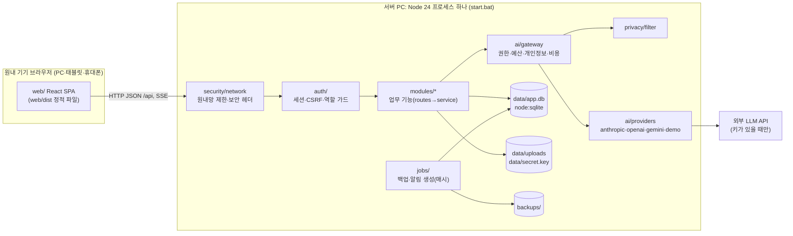
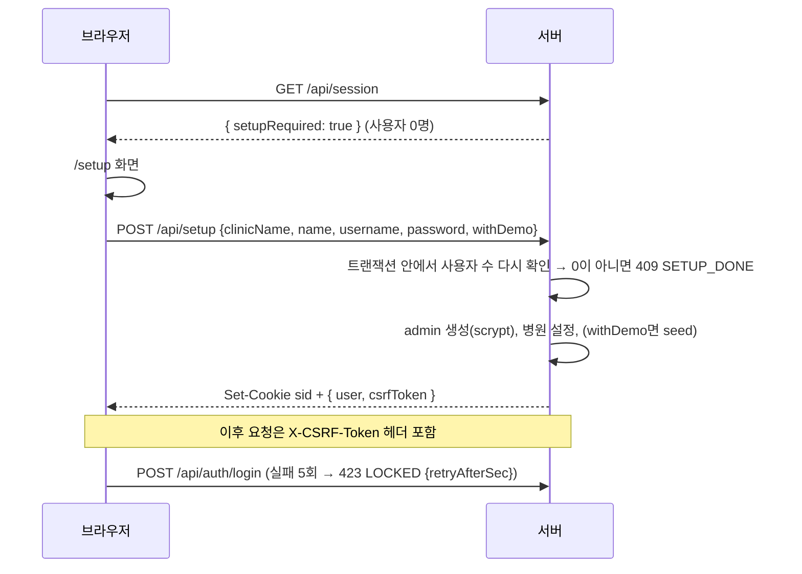
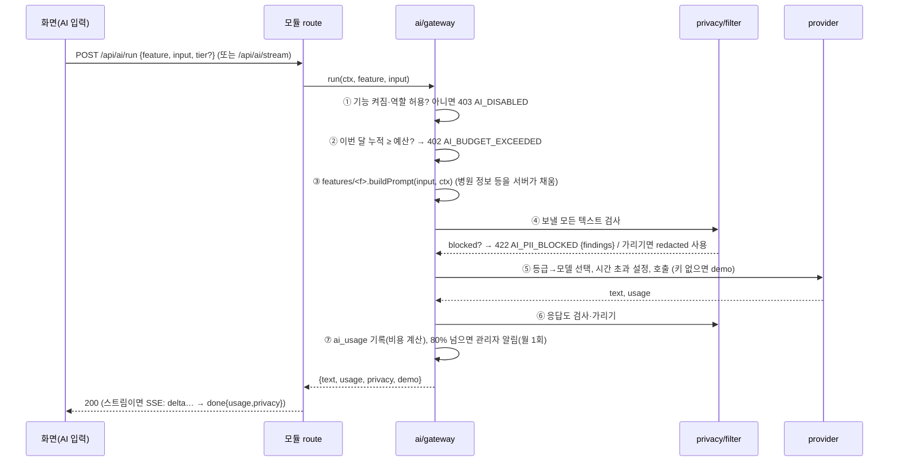

# Architecture Overview

> 상태: **v1.0 (2026-11-02)** — 입력: PRD v1.1, TRD v1.0, DESIGN(승인)
> 하위 문서: [database.md](database.md) · [backend.md](backend.md) · [frontend.md](frontend.md)
> 다음 단계: `plan-generator`

## 1. 구성과 경계



**의존 방향** (위가 아래를 부르고, 반대 방향 호출은 금지)
- `routes → service → db`
- `service → ai/gateway → privacy`, `ai/providers`
- `shared/`는 서버와 화면이 함께 import하는 타입·스키마·상수다. `shared`는 다른 폴더를 import하지 않는다.
- 모듈끼리는 상대 모듈의 `service`가 export한 함수만 부른다. 다른 모듈의 테이블을 직접 SQL로 읽는 것은 대시보드·알림 집계 쿼리(`modules/dashboard`, `jobs/notify`)에서만 허용한다.

### 폴더 지도

```
start.bat / stop.bat           매일 켜고 끄기 (TD-019)
package.json                   루트 한 개(workspace 없음). scripts가 Loop 게이트 명령
shared/                        서버·화면 공용: roles.ts(권한 표), ai-features.ts, enums.ts, schemas/*.ts(zod), privacy-rules.ts
server/
  main.ts                      진입점: 설정 로드 → DB 열기·마이그레이션 → buildApp → listen → jobs 시작
  app.ts                       buildApp(deps): Fastify 인스턴스. 테스트가 deps(clock, dataDir, aiBaseUrls)를 주입
  config.ts                    data/config.json 읽기(포트, allowExternal, 백업 보관 개수 등)
  lib/                         dates(KST·D-day), clock, errors(AppError·한국어 코드), csv, crypto(AES-GCM), files(매직넘버), net(IP 판별)
  db/                          index.ts(래퍼: open/close/tx/all/get/run), migrate.ts, migrations/NNN_*.sql, seed/(demo.ts, legal-templates.ts, ad-rules.ts)
  security/                    headers.ts, network.ts
  auth/                        password.ts, sessions.ts, csrf.ts, guard.ts(requireAuth/requireRole/requireCap), routes.ts
  privacy/                     filter.ts (shared/privacy-rules 사용)
  ai/                          gateway.ts, pricing.ts, budget.ts, stream.ts(SSE), providers/*.ts, features/*.ts(기능별 프롬프트·입력 스키마·데모 응답)
  jobs/                        scheduler.ts, backup-job.ts, notify-job.ts
  modules/<name>/              routes.ts · service.ts · (sql.ts)  ← 모듈 목록은 backend.md §3
web/
  src/main.tsx, App.tsx, routes.tsx
  src/styles/                  tokens.css(DESIGN §2) · base.css · print.css
  src/components/              공용 UI (frontend.md §2)
  src/layout/                  AppShell · Sidebar · Topbar · BottomNav · OfflineBanner
  src/lib/                     api.ts(CSRF·오류) · useApi.ts · format.ts · clipboard.ts · image.ts(축소) · privacy.ts(입력 중 경고)
  src/pages/<area>/            화면 (frontend.md §3)
  public/                      fonts/PretendardVariable.woff2 · icons · manifest.webmanifest
  dist/                        빌드 결과(저장소에 포함)
tests/e2e/                     Playwright 시나리오 · fixtures
scripts/                       check-file-headers.ts · check-docs.ts · perf.ts · screenshots.ts · e2e-server.ts
data/  (git 제외)              app.db · secret.key · config.json · uploads/ · logs/ · server.pid
backups/ (git 제외)
```

## 2. 공통 규칙 (모든 모듈에 적용)

| 규칙 | 내용 | 근거 |
|---|---|---|
| 요청 처리 순서 | 원내망 검사 → 정적 파일이나 `/api` 구분 → 세션 확인 → (상태 변경 요청이면) CSRF·Origin 검사 → 역할/권한 가드 → zod 입력 검증 → service → 감사 기록 → 응답 | TD-004·006·007 |
| 권한 | `shared/roles.ts`의 `CAPS` 표(기능 → 허용 역할)가 유일한 기준이다. 서버 가드와 화면 메뉴 숨김이 같은 표를 쓴다 | FR-003, PRD §2 |
| 응답 형식 | 성공: `{ data }`, 목록: `{ data: [...], total }`. 실패: HTTP 상태 + `{ error: { code, message, fields? } }` 형식이고 `message`는 한국어 | NFR-009 |
| 감사 | 상태를 바꾸는 service 함수는 `audit(ctx, action, targetType, targetId, detail)`을 호출한다. `detail`에 개인정보·AI 원문·키를 넣지 않는다 | FR-005 |
| 시간 | 모든 "지금"은 주입된 `clock.now()`에서 가져온다. 날짜 계산은 `lib/dates.ts`에서만 한다 | TD-020 |
| SQL | prepared statement와 바인딩만 쓴다. 동적 정렬 열은 허용 목록으로 고른다 | NFR-002 AC3 |
| 삭제 | 기록이 연결된 업무 데이터는 소프트 삭제(`active=0` 또는 `deleted_at`)한다. 감사 로그는 DB 트리거로 UPDATE·DELETE를 금지한다 | FR-005 AC3, FR-050 AC3 |
| 주석 | 모든 파일 첫 줄 근처에 `// 이 파일이 하는 일: ...`(CSS·SQL은 각 문법의 주석)을 둔다 | NFR-010 |
| 개인정보 | 환자 관련 열 이름을 금지한다(database.md §4). AI 입력은 반드시 gateway를 지나간다 | NFR-001 |

## 3. 핵심 흐름

### 3.1 첫 실행·로그인 (FR-001·002)



- 세션 확인은 매 요청마다 `sessions.expires_at > now`로 하고, 맞으면 `expires_at = now + 8h`로 늘린다.
- 비활성 사용자의 세션은 `users.active=0`이 되는 순간 삭제한다.
- `must_change_pw=1`이면 `/api/auth/password` 외의 API에 `403 PASSWORD_CHANGE_REQUIRED`를 돌려준다.

### 3.2 AI 호출 (모든 AI 기능 공통, FR-030~038)



- **오류 변환**: 공급자의 401/403 → `AI_AUTH`, 429 → `AI_RATE_LIMIT`, 시간 초과 → `AI_TIMEOUT`, 5xx → `AI_UNAVAILABLE`, 연결 실패 → `AI_NETWORK`. 문구는 backend.md §5에 있다. 실패한 호출도 `ai_usage`에 `status=error`로 남긴다.
- **기능별 동작**: `ai/features/<id>.ts`가 `{ id, inputSchema, buildPrompt, demo, postProcess? }`를 export한다. 목록과 기본값(등급, 역할, 시간 초과, 최대 토큰)은 `shared/ai-features.ts`에 있다.
- **사진 기능**(receipt): 화면에서 1600px로 줄이고 확인 체크를 한 뒤 multipart로 올린다. route가 크기를 검사한 다음 gateway에 `images`로 넘긴다. 사진 자체는 필터가 검사할 수 없으므로 ⑥의 응답 검사가 핵심이다. 모델 표에서 `supports_images=0`이면 `AI_DISABLED`(사유: 사진 미지원)를 돌려준다.

### 3.3 출고 → 재고 경고 → 발주서 → 입고 (FR-050~055)

1. `POST /api/inventory/moves {itemId, type:'out', qty}` → `stock_moves`에 한 줄 추가(트랜잭션). 응답은 갱신된 품목 상태다.
2. 품목의 상태(`ok | low | soon_low | expiring | expired`)는 저장하지 않고 조회할 때 계산한다(database.md §3.2). 상태가 경고로 바뀌면 `notify.emit('stock_low', dedupe=item:<id>:<yyyy-mm-dd>)`로 실장 이상에게 알린다.
3. `POST /api/orders/draft` → 부족·곧 부족 품목을 기본 거래처별로 묶어 `purchase_orders(status=draft)`와 `po_lines`를 만든다. 수량은 `ceil(par × 1.5 − stock)`이다.
4. `PATCH` 수정 → `POST /api/orders/:id/order`(발주함) → 인쇄 경로 `/print/order/:id`
5. `POST /api/orders/:id/receive {lines:[{itemId, qty, unitPrice, lot?, expiry?}], alsoExpense?}` → `stock_moves` in 여러 줄(order_id 연결), 필요하면 `expenses`도 추가하고 `status=received`로 바꾼다. 모두 한 트랜잭션이다.

### 3.4 명세서 사진 입고 (FR-122)
- 화면 순서: 사진 선택 → 경고 확인 체크 → 축소 → `POST /api/ai/receipt` (multipart)
- 서버 응답: gateway 결과 JSON `{vendorName, date, lines:[{name, qty, unitPrice, amount}], total}`과, 각 줄에 붙인 기존 품목 후보(2-gram 유사도 상위 3개)
- 사용자가 확인·수정한 뒤 `POST /api/inventory/receipt-commit` → 3.3의 5번과 같은 입고 트랜잭션. 사진 파일은 `files(purpose='receipt')`로 남기고 `expenses.file_id`에 연결한다.

### 3.5 원내 AI 도우미 (FR-070·071, TD-011)

1. **올리기** `POST /api/kb/docs` (multipart 또는 `{documentId}`)
   - 텍스트를 추출한다.
   - 개인정보 검사를 한다. 감지되면 `status=needs_review`와 findings를 응답한다. 화면이 "가리고 저장" 또는 "취소"를 고르게 한다.
   - 약 600자 조각(앞뒤 100자 겹침)으로 나눠 `kb_chunks`에 넣고, 2-gram을 `kb_fts`에 넣은 뒤 `ready`로 바꾼다.
   - 추출에 실패하면 `failed`와 이유를 남긴다.
2. **질문** `POST /api/assistant/ask {question}`
   - 2-gram으로 FTS를 검색한다. 사용자 역할에 맞게 `visibility`를 거르고 BM25 상위 6개를 뽑는다.
   - 결과가 없거나 최고 점수가 기준에 못 미치면 AI를 호출하지 않고 `found=false`를 돌려준다.
   - 결과가 있으면 gateway(feature `assistant`)를 부른다. 데모 모드에서는 상위 조각 발췌로 답 형식을 만든다.
   - 응답: `{answer, sources:[{kbDocId, title, chunkId, excerpt}], found}`. 이 내용을 `assistant_messages`에 저장한다.

### 3.6 연차 신청 → 승인 → 근무표 (FR-080·081)
- 신청 `POST /api/leave` → `pending`으로 저장되고, manager 이상에게 `leave_requested` 알림이 간다.
- 결정 `POST /api/leave/:id/decide {approve, reason?}`
  - 반려하면 사유가 필수다.
  - 승인하면 근무표 조회 때 해당 날짜에 "휴가"가 덧씌워져 표시된다. `roster` 원본은 바꾸지 않는다.
  - 결과는 신청자에게 알림으로 간다.
- 같은 날 승인 수가 `settings.leave.maxPerDay`를 넘으면 응답에 `warnings`를 넣는다.

### 3.7 백업·복원 (FR-006, TD-014)
- `jobs/scheduler`는 시작할 때 한 번, 그 뒤 매시 정각에 `backupJob.ensureDaily()`를 부른다. 오늘 날짜 백업이 없으면 만든다.
- 복원 `POST /api/backups/:name/restore {confirm:'복원합니다'}`
  1. 전역 `maintenance=true`로 바꿔 다른 API에 503 `MAINTENANCE`를 돌려준다.
  2. 현재 상태를 `pre-restore` 이름으로 백업한다.
  3. DB를 닫는다.
  4. `app.db`·`uploads`·`secret.key`를 교체한다.
  5. DB를 다시 열고 마이그레이션을 적용한다.
  6. 세션을 전부 삭제한다.
  7. `maintenance=false`로 되돌린다.
  - 중간에 실패하면 `pre-restore`로 되돌린다.

### 3.8 알림 생성 (FR-090)
- **즉시 알림**: 공지, 연차, 멸균 불합격, 예산 80%. 해당 service가 `notify.emit`을 호출한다.
- **기한형 알림**: 재고 부족, 유효기간, 법정·장비 일정, 교육 예정. `jobs/notify-job`이 서버 시작 때와 매시에 계산한다.
- 알림마다 `dedupe_key`를 둬서 같은 날 중복 알림을 막는다.
- 받는 사람 규칙: 재고·발주·연차 신청·멸균 불합격·법정·장비는 manager 이상, 예산은 admin, 공지는 전원, 연차 결과는 신청자, 교육은 해당 직원과 manager 이상.

## 4. 실행·검증 경계 (Harness·Loop 연결)

| 항목 | 계약 |
|---|---|
| 데이터 위치 | 환경 변수 `DATA_DIR`(기본 `./data`), `BACKUP_DIR`(기본 `./backups`). 테스트는 임시 폴더를 쓴다 |
| 포트 | `PORT`(기본 8090). E2E는 18090 |
| 시간 주입 | `buildApp({clock})`. E2E 서버는 `TEST_NOW=2026-11-02T09:00:00+09:00`이면 고정 clock을 쓴다(production에서는 무시) |
| AI 대상 | `AI_BASE_URL_ANTHROPIC/OPENAI/GEMINI`로 가짜 서버를 가리킬 수 있다(테스트 전용). 키가 없으면 demo |
| 원내망 검사 | 테스트에서 `fastify.inject`의 `remoteAddress`로 외부 IP를 흉내 낸다 |
| 게이트 명령 | `npm run lint` · `npm run test:unit` · `npm run test:e2e` · `npm run validate -- <TASK-ID>`(Harness에서 정의) |
| 화면 산출물 | `npm run screenshots` → `artifacts/screens/<page>-<width>-<theme>.png` |
| 실행 확인 | `npm start`(= `node --disable-warning=ExperimentalWarning server/main.ts`) 후 `GET /api/health` → `{ok:true, version, db:'ok'}` |

## 5. NFR 실현 지점

| NFR | 구조상 위치 |
|---|---|
| NFR-001 | database.md §4 금지어 + 스키마 검사 테스트, `ai/gateway` 단일 통로 |
| NFR-002 | `security/*`, `auth/*`, zod, 업로드 검사(`lib/files`), CSV 수식 이스케이프(`lib/csv`) |
| NFR-003 | `start.bat`, `web/dist` 포함, 네이티브 의존성 없음 |
| NFR-004 | `data/` 한 폴더 + `jobs/backup-job` |
| NFR-005 | 인덱스(database.md §3), 재고 합계는 `item_id` 인덱스로 집계, 대시보드 API 하나로 묶음, 목록 페이지 크기 상한 200 |
| NFR-006·007 | frontend.md §1–2 토큰·컴포넌트, 상태 3종 컴포넌트 강제 |
| NFR-008 | `ai/providers/demo.ts`, `features/*.demo` |
| NFR-010 | `scripts/check-file-headers.ts` |

## 6. 충돌·잠정

- **충돌(CF)**: 0건. PRD·TRD·DESIGN과 맞지 않는 곳이 없다. 설계로 정한 세부 결정:
  - 서식 보관함 업로드·삭제는 manager 이상, 조회는 전원이다(PRD 권한 표 "품목 등록" 행의 원칙을 따름).
  - 인수인계 수정·삭제는 작성자와 manager 이상만 한다.
- **잠정**
  - `ai/providers/openai.ts`의 엔드포인트는 OQ-009(구현 때 공식 문서로 확인)에 따라 정한다.
  - 원내 도우미의 점수 기준값은 OQ-008 실험 결과로 정한다. 초기값은 BM25 상위 결과 존재 여부와 최소 일치 2-gram 비율 0.3이다.
- **자체 점검에서 고친 것**
  - 입고 권한을 S로 바꿨다(PRD 권한 표 "입출고 기록 = staff ✅"에 맞춤).
  - AI 기능의 기본 역할을 모두 S로 바꿨다(IDEA 4절 "전 직원 사용"에 맞춤).
- **미검증**
  - 이 문서의 계약은 아직 코드로 실행해 보지 않았다. 검증은 Plan의 태스크와 Harness 게이트가 한다.
  - Mermaid 그림은 렌더링 도구가 없어 그림으로 확인하지 못했다.

## 변경 이력
- 2026-11-02 v1.0 작성
