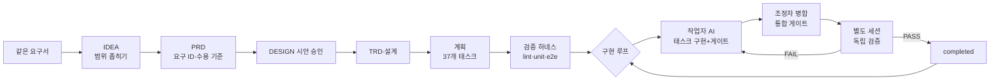

# 이 프로젝트는 어떻게 만들어졌나 (BUILD STORY)

> 처음으로 → [README](../README.md) · 단일 프롬프트와 비교 → [COMPARISON](COMPARISON.md) · 입력한 프롬프트 → [prompts/prompt.md](prompts/prompt.md)

## 왜 다시 만들었나

같은 요구서를 프롬프트 한 번에 넣어 만든 [단일 프롬프트판](https://github.com/GangJaeYu/DentalAX)은 약 1시간 45분 만에 그럴듯한 서비스를 만들어 냈습니다. 하지만 병원에서 매일 쓰는 **상용 서비스**가 되려면 두 가지를 증거로 확인할 수 있어야 합니다.

- 요구한 것이 빠짐없이 들어갔는가
- 만든 AI의 "다 됐습니다"를 믿어도 되는가

이번 판은 같은 요구서를 **`harness_loop_fullstack_kor` 플러그인**의 절차에 태워서 이 두 질문에 답하도록 만들었습니다. 절차는 요구 → 설계 → 계획 → 검증 하네스 → 구현 루프 → 독립 검증입니다.

## 조건

| 항목 | 내용 |
|---|---|
| 도구 | Claude Code |
| 모델 | **Claude Opus 5.5**(조정자·구현 작업자·검증자 모두) |
| 입력 | 단일 프롬프트판과 같은 요구서 + "플러그인으로 아이디어부터 진행하자" 한 줄 → [prompts/prompt.md](prompts/prompt.md) |
| 플러그인 | `harness_loop_fullstack_kor`(아이디어·PRD·TRD·설계·계획·하네스·루프 스킬) → 저장소·설치 방법: [GangJaeYu/harness_loop_full_korean](https://github.com/GangJaeYu/harness_loop_full_korean) |
| 병렬 실행 | Orca 작업 사본(git worktree)마다 작업자 AI 1명. 구현 최대 4명 + 검증 최대 4명 동시 |
| 사람의 개입 | 기획 단계 선택 약 20회(선택지 고르기). **루프 중 제품 질문 0회**(중단·재개, PC 부하 알림만) |
| 작업 PC | Windows 11, Node.js 24 |

## 사용한 플러그인 스킬과 산출물

| 순서 | 스킬 | 한 일 | 산출물 |
|---|---|---|---|
| 1 | `idea-brainstorm` | 기능 후보를 넓게 펼친 뒤 질문·선택지로 범위를 좁힘 | [IDEA.md](IDEA.md) |
| 2 | `prd-generator` | 요구마다 ID(FR-xxx·NFR-xxx)와 **관찰 가능한 수용 기준(AC)**, 자율운영 합의(24시간 한도·금지 행동·예산) | [PRD.md](PRD.md) |
| 3 | 디자인 시안 | 실제 화면 시안 HTML을 보여 주고 승인을 받음(청록 A + 기본 밀도, 기준선 스크린샷) | [DESIGN.md](DESIGN.md), [design/](design/) |
| 4 | `trd-generator` | 기술 선택과 근거·검증 수단(Node 24 내장 SQLite, Fastify, React, 공급자 API 형식·가격 확인) | [TRD.md](TRD.md) |
| 5 | `architecture-generator` | 모듈 경계, DB 표, API 계약, 화면 구조 | [ARCHITECTURE/](ARCHITECTURE/) |
| 6 | `plan-generator` | 6개 phase · **37개 태스크**. 태스크마다 수용 기준·선행·파일 범위 | [plan_setup/](../plan_setup/), [PLAN.md](PLAN.md) |
| 7 | `harness-setup` | 검증 게이트 4종(lint → unit → e2e → task_validation)과 실행 스크립트 | [harness_setup/](../harness_setup/) |
| 8 | `loop-setup` | 조정자·작업자·검증자 역할, 포트 슬롯, 재시도·재개 규칙 | [loop_setup/](../loop_setup/) |

루프 중에는 같은 플러그인의 규칙을 그대로 따랐습니다.
- **완료 조건**: 선행 태스크가 모두 완료되었고, 별도 세션의 독립 검증이 PASS일 것
- **기록**: 모든 결정은 [DECISIONS.md](DECISIONS.md)에 적었습니다(100여 건). 진행은 [STATE](../plan_setup/STATE.md)·[LOG](../plan_setup/LOG.md)에 남겨서, 중간에 끊겨도 이어서 할 수 있게 했습니다.

## 진행 구조

## 실제 진행 시간표 (2026-11-02 ~ 11-03, 커밋·기록 기준)

| 시각 | 한 일 |
|---|---|
| 11-02 17:10 | 프롬프트 입력 → 아이디어 정리(선택지 문답) |
| 17:10–18:40 | PRD(수용 기준), 디자인 시안 2회(사용자 지적 반영 후 승인), TRD, 설계, 37개 태스크 계획, 검증 하네스 |
| 18:55 | **루프 시작**(사용자 승인). 01-01 프로젝트 골격 구현 |
| 19:31 | 첫 독립 검증 **불합격**: 한글 Windows 새 콘솔에서 `start.bat` 첫 줄이 깨지고 주석이 명령으로 실행됨 → 고침 |
| 20:00–20:38 | 두 번째·세 번째 불합격: 다른 프로그램이 IPv6로 포트를 쓰면 충돌을 놓침 → 서버가 켜진 뒤 스스로 확인하는 방식으로 고침 |
| 21:42 | phase-01(기반: DB·인증·권한·디자인 시스템·관리) 완료 |
| 22:28 | phase-02(개인정보 필터·AI 게이트웨이·알림·백업) 완료 |
| 22:13–02:08 | phase-03(핵심 모듈 10개)·phase-04(확장 8개) 병렬 구현·검증 |
| 11-03 02:36 | 사용자 요청으로 안전하게 중단(작업 사본 정리, 재개 지점 기록) |
| 08:02 | 재개(중단 시간은 24시간 한도에서 뺌). 남은 검증·병합 |
| 10:40 | 대시보드 재검증 통과(768px 카드 넘침 수정) → phase-03·04 완료 |
| 10:30–11:50 | phase-05: 성능 측정, 보안 점검(결함 3건 수정), 전체 화면 640장·접근성·키보드 점검, 사용자 문서 |
| 14:10 | 깨끗한 폴더에서 설치 리허설 독립 검증 통과 → phase-05 완료 |
| 11:20–17:00 | P2(바코드 출고·AI 근무표 제안·녹음 회의록) 구현·통합·검증(1건 불합격 → 수정 → 재검증 통과) |
| **11-03 17:00** | **37/37 태스크 완료, 루프 종료** |

## 독립 검증이 잡은 문제 (만든 AI는 "됐다"고 보고했던 것들)

구현한 AI는 매번 자기 게이트(lint·unit·e2e)를 통과시킨 뒤 "완료"를 보고했습니다. 그래도 그 작업을 **보지 않은 별도 세션**이 수용 기준을 하나씩 직접 재현하자 아래 문제가 나왔습니다. 전부 출시 전에 고쳤습니다.

| 태스크 | 독립 검증이 찾은 문제 | 사용자에게 생겼을 일 | 고친 방법 |
|---|---|---|---|
| 01-01 실행 스크립트 | 한글 Windows(코드 페이지 949) 새 창에서 `start.bat`을 열면 첫 줄에 깨진 영어 오류가 나오고 주석 일부가 명령으로 실행됨 | 원장님이 더블클릭하자마자 깨진 오류 문구를 봄 | 1~4행을 ASCII로만 쓰고, 한국어 본 스크립트는 새 cmd로 실행 |
| 01-01 포트 충돌 | 다른 프로그램이 IPv6(`[::]`)로 같은 포트를 쓰면 충돌을 알아채지 못하고 "켜졌어요"라고 안내. 브라우저는 다른 프로그램으로 감 | 화면이 안 뜨는데 이유를 모름 | 시작 전 확인 + 켜진 뒤 고유 번호로 자기 확인 |
| 02-05 백업 화면 | 화면 기준(넘침·상태) 불합격 | 백업 화면 일부가 깨져 보임 | 수정 후 재검증 |
| 03-10 대시보드 | 태블릿(768px)에서 점검 카드의 "조치 필요" 칩이 카드 밖으로 넘침 | 태블릿에서 중요한 경고가 잘림 | 격자 `minmax(0,1fr)` + 회귀 테스트 |
| 04-03·04-06 | 한 번에 판정할 수 없는 기준이 남아 "부분 통과" | — | 선행 화면이 생긴 뒤 남은 기준만 재검증 |
| 05-02 보안 점검 | ① 가격표 출처 링크에 `javascript:` 허용 ② 원내 도우미 "못 찾음" 기록에 **주민번호 앞자리가 그대로 저장** ③ 입력 검사 라이브러리가 CSP를 어기는 `eval` 사용 | 관리자 클릭 한 번으로 스크립트 실행 가능, 대화 기록에 개인정보가 남음, 보안 정책 위반 | http(s)만 허용, 가린 질문만 저장, eval 없는 모드 |
| 05-04 문서 | 비용 절약 예시 숫자 오류(950원을 170원으로 적음), 출처에 없는 문구 | 원장님이 비용을 잘못 판단 | 다시 계산해 수정 |
| 06-03 녹음 회의록 | 상태 확인 요청이 실패하면 "확인하고 있어요…"에서 영원히 멈춤 | 화면이 멈춘 것처럼 보임 | 오류 안내 + "다시 시도" + 로딩 뼈대, 회귀 테스트 |

독립 검증 보고서는 모두 [harness_setup/evidence/](../harness_setup/evidence/)에 있습니다. 46건이고, 그중 불합격은 7건입니다(1건은 PC 부하로 인한 시간 초과).

## 운영 중 생긴 일 (숨기지 않고 기록)

- 테스트용 가짜 키로 실제 Anthropic API에 요청 1건이 나감 → 401 거절, 비용 0원. 이후 테스트 서버가 실제 공급자를 기본 차단
- 검증 세션이 조정자의 테스트 서버를 종료한 사고 → 작업 사본마다 포트 슬롯을 나누고 "직접 띄운 프로세스만 종료" 규칙 추가
- 여러 세션이 동시에 돌 때 소켓 부족·메모리 부족·시간 초과 → PC 전체에서 무거운 검사 동시 2개(사용자가 다른 작업 중일 때 1개) 제한, e2e 한도 60초
- 조정자가 e2e 도중 화면을 다시 빌드한 실수 → 그 회차를 버리고 다시 실행

## 결과물 (완성 시점 숫자)

| 항목 | 숫자 |
|---|---|
| 걸린 시간 | 기획 약 1.75시간 + 루프 약 16.7시간 = **약 18.4시간**(중단 5.4시간 제외) |
| 사람의 개입 | 기획 단계 선택 약 20회 · 루프 중 제품 질문 0회 |
| 제품 코드 | **약 53,800줄**: 서버 20,900 · 공유(타입·검증 규칙) 4,400 · 화면 23,200 · 스타일 1,800 · 스크립트 3,500 |
| 테스트 코드 | **약 25,600줄**(143개 파일) |
| 문서 | 사용자 문서 약 3,900줄 + 계획·하네스·루프 기록 약 11,000줄 |
| 화면 / DB 표 / API | 앱 화면 47개 + 첫 설정·로그인 등 5개(+인쇄 6) / 41개(환자 정보 칸 0개, 테스트가 스키마 검사) / 150개 경로(보안 전수 점검) |
| AI 기능 | 16종(Claude·OpenAI·Gemini + 키 없는 데모 모드), 모두 개인정보 필터·예산·비용 기록을 거침 |
| 자동 테스트 | 단위 **812건** + 화면(e2e) **335건** 모두 통과(건너뜀 0, 흔들림 0) |
| 독립 검증 | 46건(37개 태스크 전부 PASS로 마감) |
| 화면 점검 | 80개 화면 × 4너비 × 2테마 = 640장, 접근성(axe) 위반 0, 키보드만으로 핵심 업무 완료 |
| 성능 | 10배 데이터에서 목록 API p95 최악 약 0.11초, 20명 동시 1분 오류 0, 첫 화면 2초 이내 |
| 실행에 필요한 외부 부품 | 9개(fastify 계열 4, 입력 검사 zod 1, 문서 읽기 2(docx·pdf), CSV 1, 압축 1) |

줄 수는 git에 올라간 파일만 셌습니다. 빈 줄은 포함했고, 빌드 결과(web/dist)·잠금 파일·그림·글꼴·검증 증거는 뺐습니다.

## 완성 후 사람이 추가로 요청한 것

- 공개 저장소용 README 정리, 화면으로 보는 사용 흐름([walkthrough](walkthrough/README.md)), 자막 시연 영상
- 단일 프롬프트판과의 비교·점검 → [COMPARISON.md](COMPARISON.md)
- 영상 음성: Windows 기본 음성은 공개 배포 조건이 불분명하다는 사용자 지적에 따라 **음성 없이 자막만** 쓰기로 함
