# 화면으로 보는 사용 흐름

치과 원내 AX 서비스(가상의 하늘숲치과 데모 데이터)를 처음 켜는 순간부터 재고·문서·AI·근무·시설·관리 화면까지, 실제로 누르는 순서대로 보여 드립니다.

▶ **[시연 영상 보기 (dentalax-demo.mp4, 약 5분 1초)](dentalax-demo.mp4)** — 음성 없이 자막으로 따라가는 영상입니다. 자막 파일 [dentalax-demo.srt](dentalax-demo.srt) · 자막 대본 [narration.md](narration.md)

> 그림을 누르면 영상 파일이 열립니다. GitHub에서 바로 재생되지 않으면 "Download"(내려받기)를 눌러 주세요.

## 1. 첫 설정

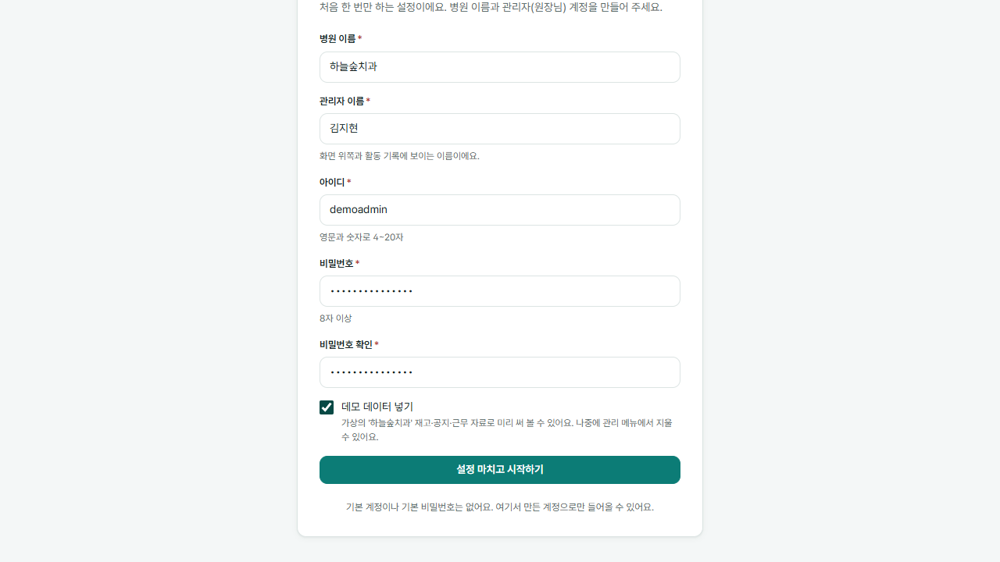

- **누가·언제**: 원장님(관리자)이 서비스를 처음 켰을 때 한 번만 합니다.
- 병원 이름, 관리자 이름, 아이디, 비밀번호를 적습니다.
- "데모 데이터 넣기"에 체크하면 가상의 하늘숲치과 예시 자료가 들어가서 바로 연습할 수 있습니다(나중에 관리 > 데모 데이터 초기화로 지울 수 있습니다).

## 2. 대시보드

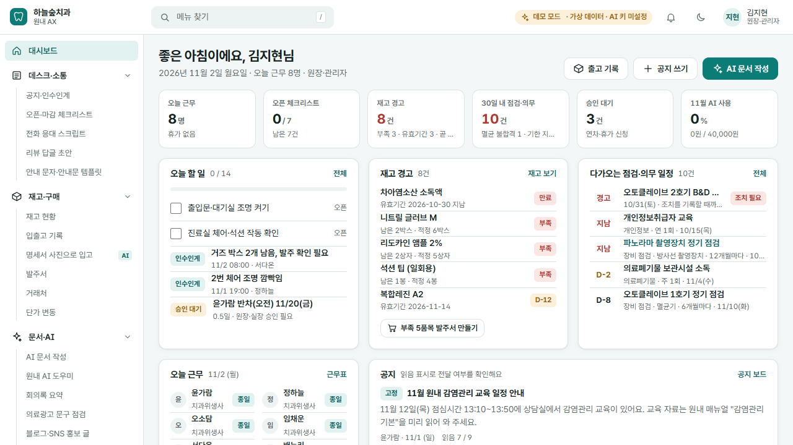

- **누가·언제**: 모든 직원이 출근해서 가장 먼저 보는 화면입니다.
- 오늘 할 일(체크리스트·인수인계·승인 대기), 재고 경고, 다가오는 점검·법정 의무 일정, 오늘 근무를 카드로 보여 줍니다.
- 숫자 칸이나 카드 항목을 누르면 그 화면으로 바로 갑니다. 직원에게는 지출·발주처럼 권한이 없는 카드는 보이지 않습니다.

## 3. 대시보드에서 출고 기록

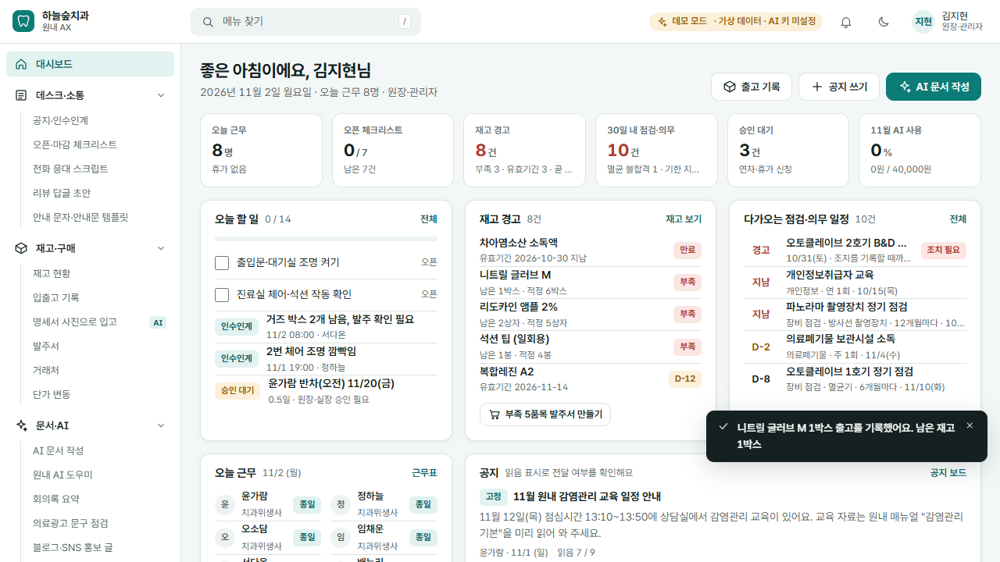

- **누가·언제**: 직원이 재료를 꺼내 쓸 때 바로 기록합니다.
- 대시보드의 "출고 기록" → 품목 고르기 → "저장", 세 번 클릭이면 끝납니다(수량은 기본 1).
- 저장하면 남은 재고가 바로 안내되고, 적정 재고보다 적어지면 재고 경고에 올라갑니다.

## 4. 공지·인수인계

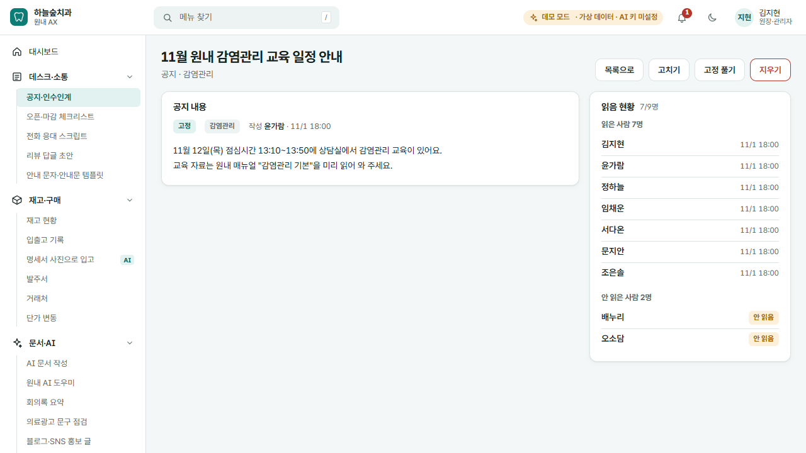

- **누가·언제**: 실장님·원장님이 공지를 올리고, 직원은 출근해서 확인합니다. 교대할 때는 누구나 인수인계를 남깁니다.
- 공지를 열면 읽음으로 표시되고, 목록에서 "읽음 몇 / 몇 명"으로 확인할 수 있습니다. 쓴 사람은 안 읽은 사람 목록도 봅니다.
- 인수인계는 "처리 전 → 처리 완료"로 바꿔 빠뜨린 일이 없게 합니다.

## 5. 오픈·마감 체크리스트

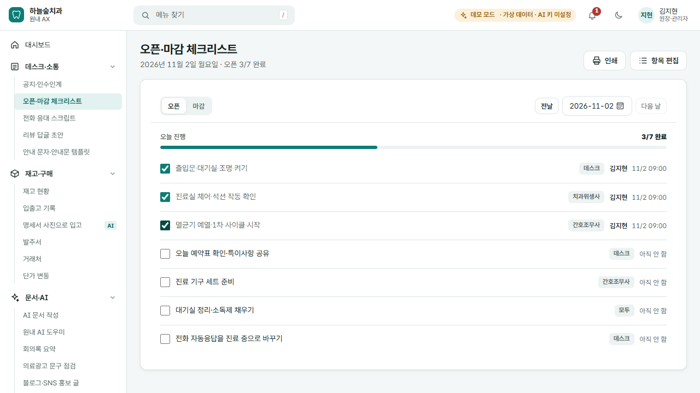

- **누가·언제**: 직원이 아침 오픈·저녁 마감 때 씁니다.
- 항목을 체크하면 체크한 사람과 시각이 함께 남고, 대시보드의 "오픈 체크리스트" 숫자도 바로 바뀝니다.
- 항목 편집은 실장님 이상이 하고, 인쇄해서 벽에 붙일 수도 있습니다.

## 6. 재고 현황

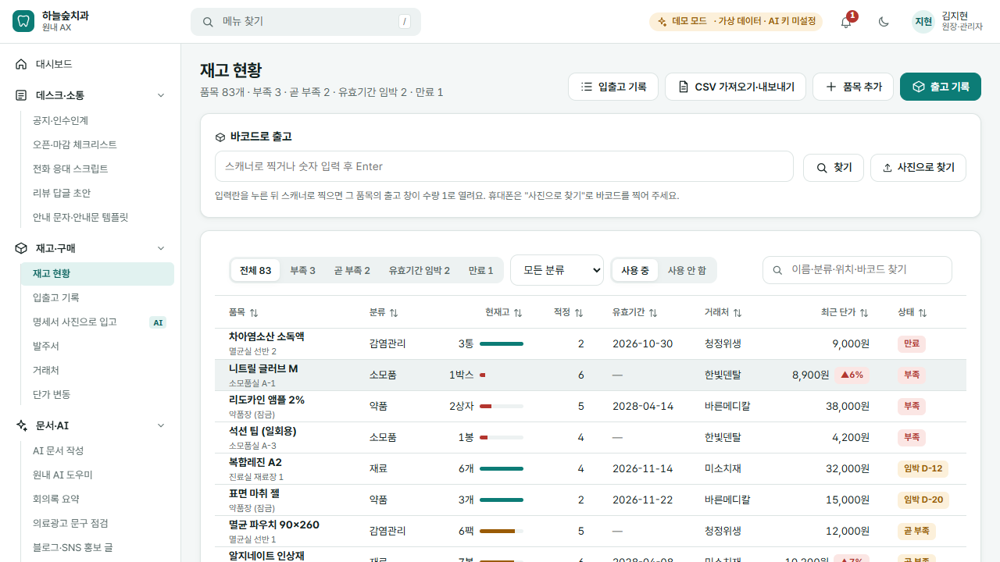

- **누가·언제**: 실장님과 재고 담당 직원이 수시로 봅니다.
- 품목별 현재 재고·적정 재고·보관 위치가 한 표에 있고, 적정 재고보다 적으면 표시가 붙습니다.
- 품목을 누르면 입출고 기록과 단가 변동을 볼 수 있습니다.

## 7. 바코드로 출고

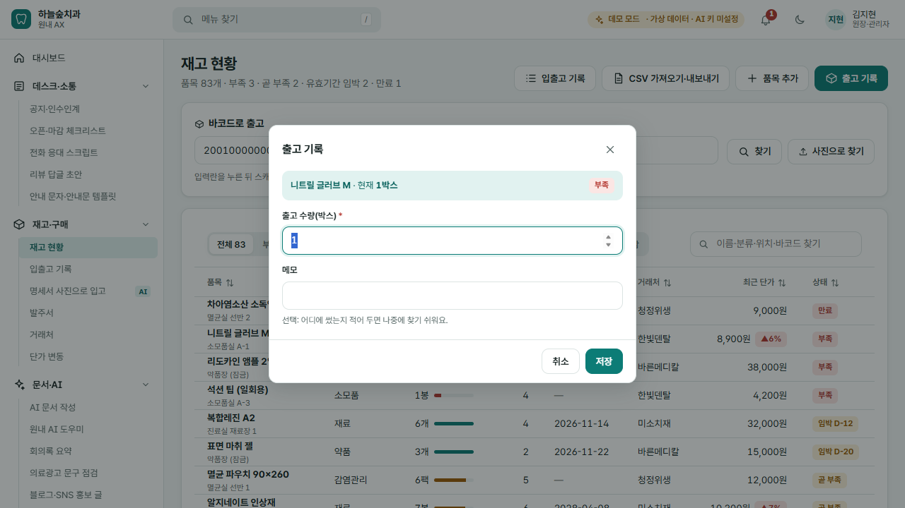

- **누가·언제**: 직원이 재료를 꺼낼 때 USB 바코드 스캐너로 찍습니다(스캐너가 없으면 숫자를 직접 쳐도 됩니다).
- 재고 현황의 "바코드로 출고" 칸에 찍으면 그 품목 출고 창이 수량 1로 열리고, "저장"만 누르면 됩니다.
- 휴대폰에서는 "사진으로 찾기"로 바코드 사진을 찍어도 됩니다(사진은 서버로 보내지 않습니다).

## 8. 발주서 만들기

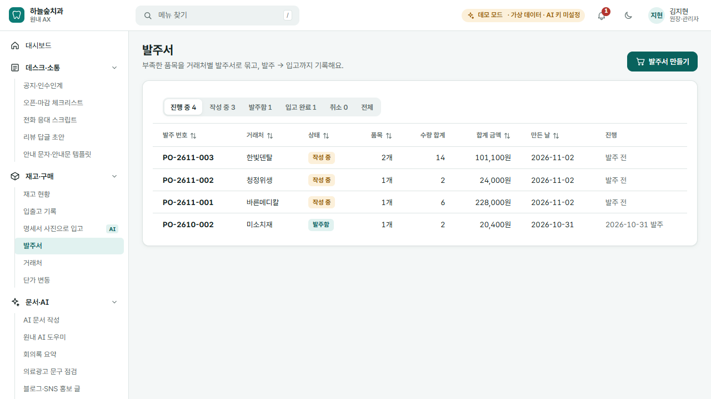

- **누가·언제**: 실장님이 주 1~2회 발주할 때 씁니다.
- "발주서 만들기"를 누르면 적정 재고보다 모자란 품목을 거래처별 발주서로 묶어 줍니다.
- 수량을 고치고 "발주함"으로 바꾸고, 물건이 오면 "입고 처리"로 재고에 더합니다. 인쇄 미리보기도 있습니다.

## 9. 명세서 사진으로 입고

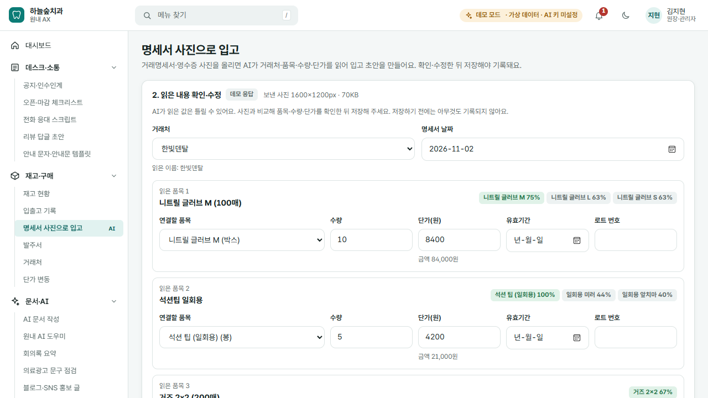

- **누가·언제**: 물건이 도착했을 때 직원이나 실장님이 씁니다.
- 거래명세서 사진을 고르고, 환자 정보·카드번호가 보이지 않는다는 확인 칸에 체크해야 보낼 수 있습니다.
- AI가 읽은 품목·수량·단가에 비슷한 기존 품목이 미리 연결되고, 확인·수정한 뒤 "입고 저장"을 누릅니다. 실장님은 지출로도 함께 기록할 수 있습니다.

## 10. AI 문서 작성

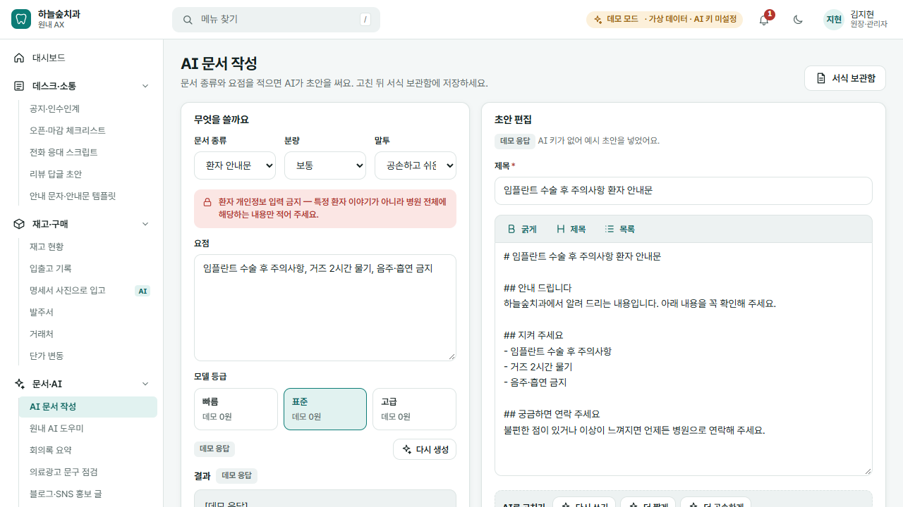

- **누가·언제**: 실장님·직원이 환자 안내문, 원내 공지문 같은 글이 필요할 때 씁니다.
- 문서 종류를 고르고 요점만 적은 뒤 "초안 만들기"를 누르면, 오른쪽에 초안이 나오고 바로 고칠 수 있습니다.
- 저장하면 서식 보관함에 버전과 함께 남습니다. AI 초안은 참고용이니 꼭 읽고 고쳐서 씁니다.

## 11. 개인정보 보호

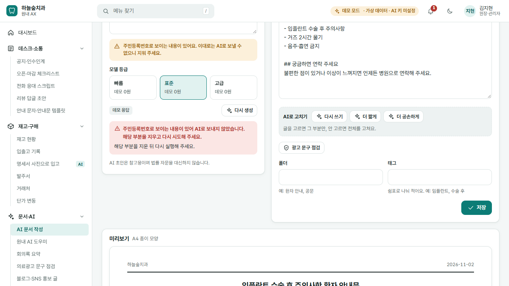

- **누가·언제**: 모든 AI 입력칸에 늘 켜져 있습니다.
- 입력칸 위에는 "환자 개인정보 입력 금지" 빨간 안내가 늘 보이고, 전화번호·주민등록번호처럼 보이는 글을 치면 노란 경고가 뜹니다.
- 주민등록번호·카드번호는 서버에서 막아 AI로 보내지 않고, 전화번호 등은 가린 뒤 보냅니다. (영상 속 번호는 가짜입니다.)

## 12. 원내 AI 도우미

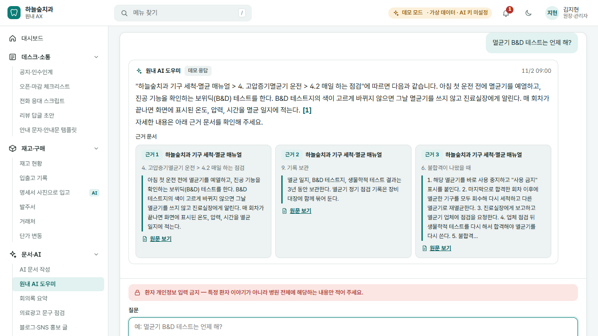

- **누가·언제**: 새로 온 직원이나 헷갈리는 규정이 있을 때 누구나 묻습니다.
- 올려 둔 원내 문서(감염관리·멸균·재고 규정 등)에서 찾아 답하고, 근거 문서를 함께 보여 줍니다. "원문 보기"로 바로 확인합니다.
- 문서에 없는 내용은 모른다고 답하고, 문서를 올리라고 안내합니다.

## 13. 회의록 요약

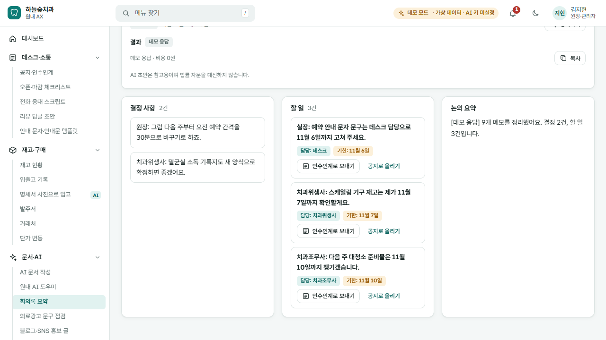

- **누가·언제**: 직원 회의가 끝난 뒤 실장님이 씁니다.
- 녹음 파일(m4a 등)을 올리고 "환자 이야기가 들어간 녹음이 아닌 것을 확인했어요"에 체크한 뒤 "받아쓰기"를 누르면 회의 메모에 글이 들어갑니다. 메모를 직접 붙여 넣어도 됩니다.
- "정리하기"를 누르면 결정 사항과 할 일(담당·기한)이 정리되고, 할 일은 인수인계로 바로 보낼 수 있습니다.

## 14. 의료광고 문구 점검

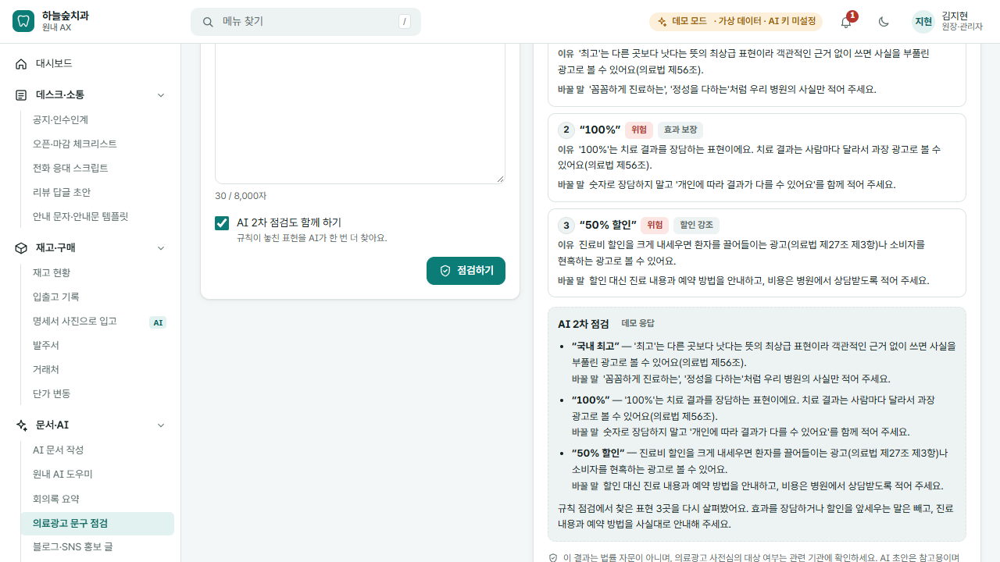

- **누가·언제**: 블로그·SNS·현수막 문구를 올리기 전에 실장님이나 담당 직원이 씁니다.
- "최고", "100%", "할인"처럼 의료법상 문제가 될 수 있는 표현에 색을 칠하고 이유와 바꿀 말을 보여 줍니다.
- 규칙 점검 뒤 AI가 한 번 더 살펴봅니다. 최종 판단은 사람이 합니다.

## 15. 근무표 · AI 배정 제안

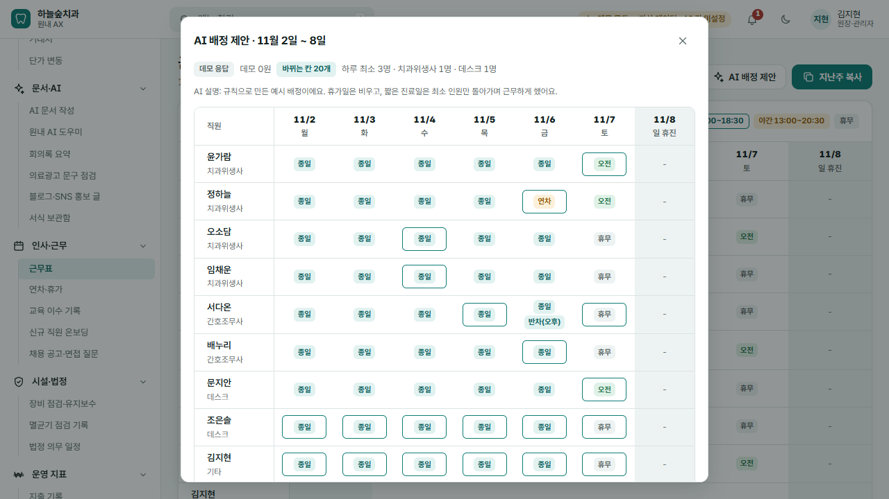

- **누가·언제**: 실장님이 다음 주 근무를 짤 때 씁니다.
- 칸을 눌러 근무 유형(종일·오전·오후 등)을 바꾸고, 연차가 승인된 날은 자동으로 "연차"로 보입니다.
- "AI 배정 제안"에 하루 최소 인원·직무별 최소 인원을 적고 "제안 받기"를 누르면, 바뀌는 칸이 표시된 미리보기가 나옵니다.

## 16. AI 배정 제안 적용

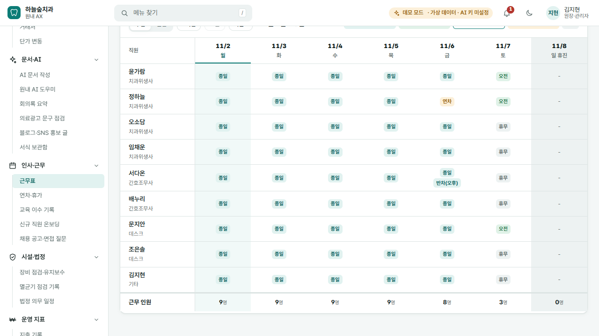

- **누가·언제**: 실장님이 AI 제안 미리보기를 확인한 뒤 결정합니다.
- "적용하기"를 눌러야 근무표가 바뀌고, "취소"하면 아무것도 바뀌지 않습니다.
- 적용한 뒤에도 칸을 눌러 직접 고칠 수 있고, 인쇄용 근무표도 있습니다.

## 17. 연차·휴가

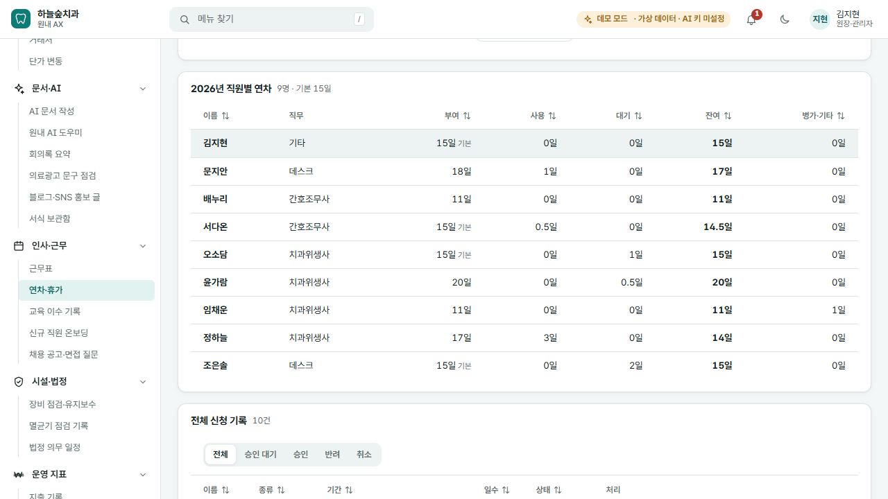

- **누가·언제**: 직원은 쉬고 싶은 날을 신청하고, 실장님·원장님이 승인합니다.
- 승인 대기 건은 대시보드 "오늘 할 일"에도 뜹니다. 승인하면 근무표에 "연차"로 들어갑니다.
- 사람마다 쓴 연차와 남은 연차가 자동으로 계산됩니다.

## 18. 장비·멸균기·법정 의무 일정

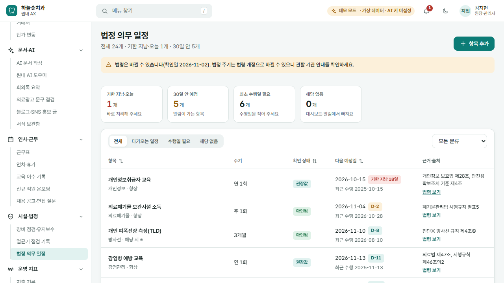

- **누가·언제**: 실장님이나 감염관리 담당 직원이 씁니다.
- 장비 점검·유지보수: 장비별 점검 주기와 수리 기록. 멸균기 점검 기록: 매일 B&D 테스트·생물학적 표지자 결과를 남기고, 불합격이면 조치를 적습니다.
- 법정 의무 일정: 방사선 장비 정기검사, 의료폐기물, 소방 점검 같은 일정을 기한 순으로 보여 주고 미리 알립니다.

## 19. 지출 기록 · 월간 요약

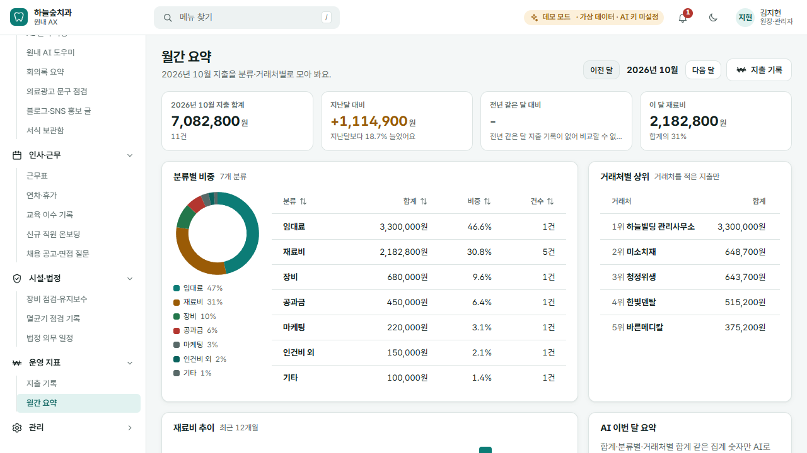

- **누가·언제**: 원장님·실장님이 씁니다(직원에게는 보이지 않습니다).
- 지출 기록: 재료비·공과금 등 쓴 돈을 적고 영수증 사진을 붙입니다. 입고 처리에서 지출로 함께 기록할 수도 있습니다.
- 월간 요약: 항목별 지출과 지난달 비교, 재고·근무 지표를 한 장으로 봅니다.

## 20. AI 설정·예산 · 사용량

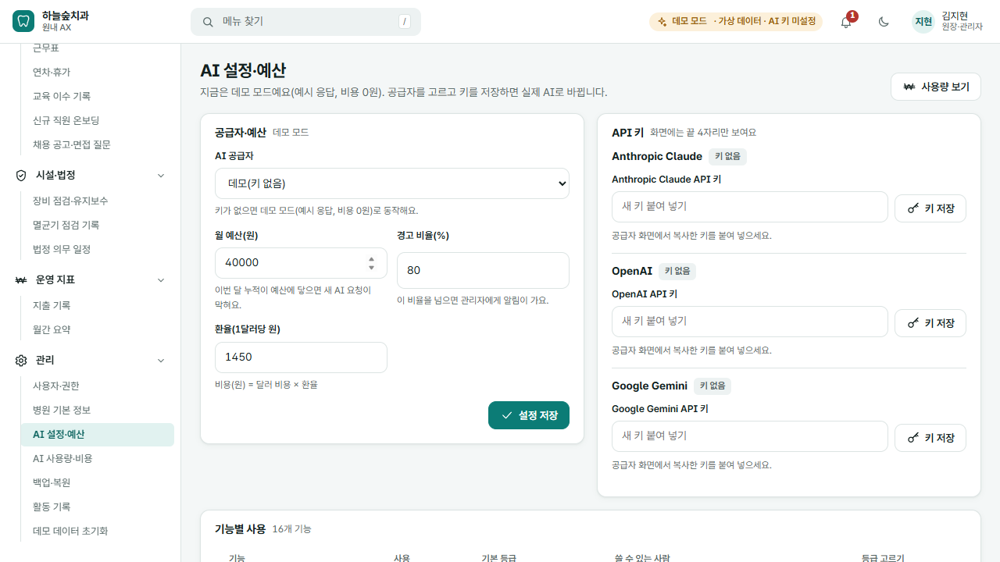

- **누가·언제**: 원장님(관리자)만 들어올 수 있습니다.
- AI 설정·예산: AI 회사 키를 넣는 칸, 월 예산, 기능별 사용 여부를 정합니다. 키를 넣지 않으면 비용 0원인 데모 모드로 동작합니다(이 영상도 데모 모드입니다).
- 월 예산을 다 쓰면 AI 요청이 멈추고 쉬운 안내가 나옵니다. AI 사용량·비용에서 기능별·사람별 사용 금액을 봅니다.

## 21. 백업·복원

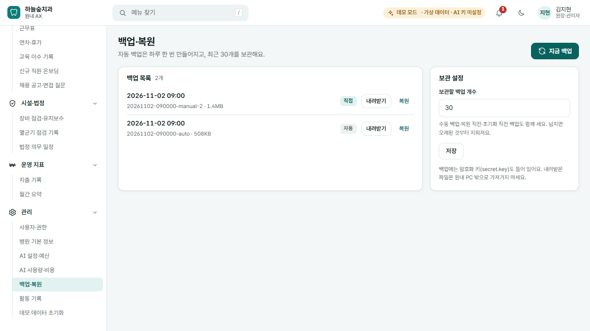

- **누가·언제**: 원장님(관리자)이 씁니다. 자동 백업은 매일 저절로 됩니다.
- "지금 백업"을 누르면 바로 백업이 만들어지고, 목록에서 내려받거나 그 시점으로 복원할 수 있습니다.
- 복원하기 전에는 한 번 더 확인을 묻습니다.

## 22. 활동 기록

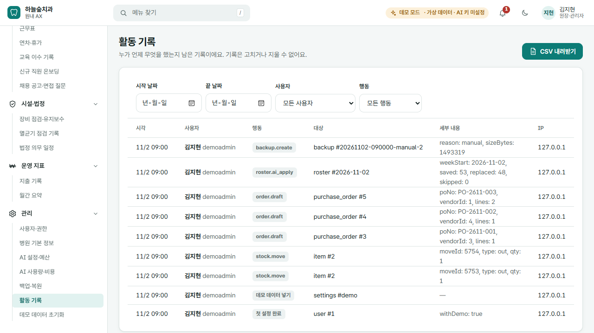

- **누가·언제**: 원장님(관리자)이 필요할 때 확인합니다.
- 로그인, 설정 변경, 백업, 데이터 수정 같은 일을 누가 언제 했는지 시간 순서로 보여 줍니다.

## 23. 휴대폰 화면

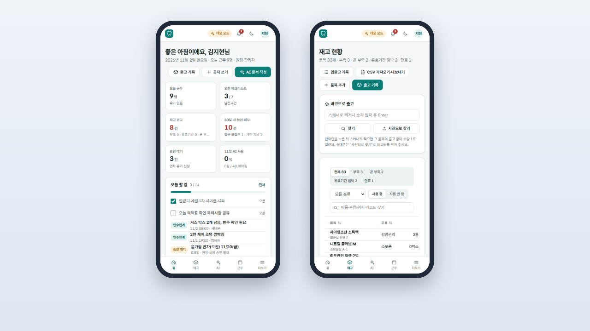

- **누가·언제**: 직원이 진료실·창고에서 휴대폰으로 씁니다(같은 와이파이 안).
- 대시보드와 재고 화면이 휴대폰 크기에 맞게 바뀌고, 아래쪽 메뉴(홈·재고·AI·근무)로 바로 갑니다.
- 홈 화면에 추가하면 앱처럼 열 수 있습니다.

## 24. 어둡게 보기

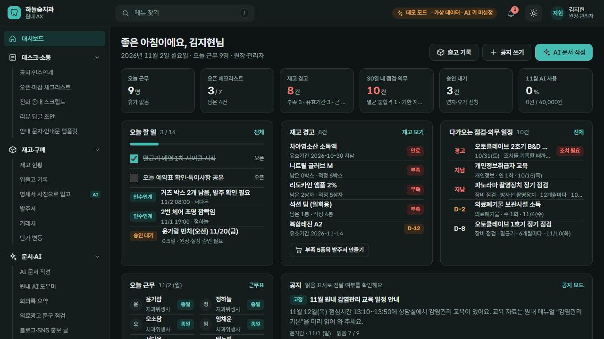

- **누가·언제**: 누구나 눈이 편한 쪽을 고릅니다(기기마다 따로 기억합니다).
- 오른쪽 위 달 모양 버튼("어둡게 보기")을 누르면 어두운 화면으로, 해 모양 버튼("밝게 보기")을 누르면 밝은 화면으로 바뀝니다.

---

이 영상·그림은 가상 데모 데이터(하늘숲치과)로 만들었고 환자 정보는 없습니다. 음성 없이 자막으로 따라가는 영상입니다.
