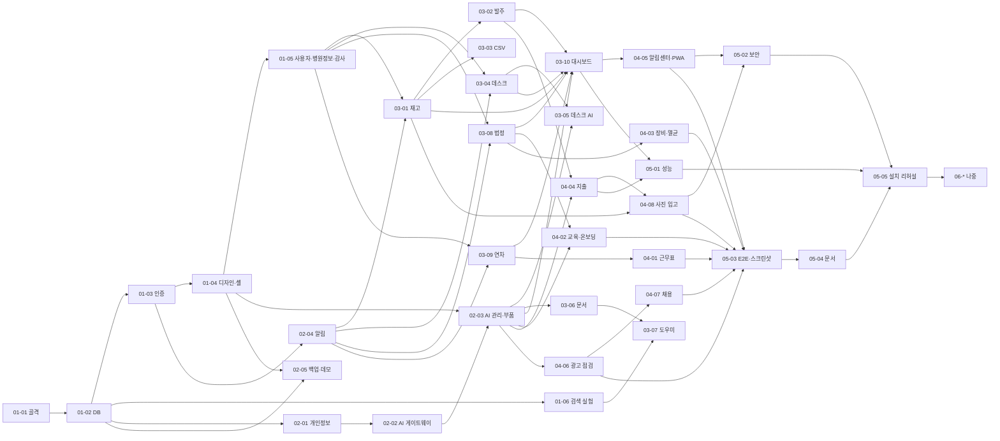

# PLAN — 기능 단위 계획 색인

> 상태: **v1.0 (2026-11-02) 작성**. 모든 태스크는 pending이고 실행 이력은 없다.
> 입력: PRD v1.1 · TRD v1.0 · ARCHITECTURE v1.0 · DESIGN(승인) · PRD `## 자율운영 합의`
> 상태 정본은 각 태스크 frontmatter의 `status`다. 재개 지점은 [STATE.md](STATE.md), 증거는 [LOG.md](LOG.md)에 있다.

## 1. Phase와 태스크

| Phase | 목표 | 태스크 |
|---|---|---|
| [01 기반](phase-01/phase-01-foundation.md) | 골격·DB·인증·디자인 시스템·공통 규칙 고정 | 6 |
| [02 공통 플랫폼](phase-02/phase-02-platform.md) | AI 게이트웨이·개인정보·알림·백업·데모 틀 | 5 |
| [03 핵심 모듈(P0)](phase-03/phase-03-core-modules.md) | 재고·발주·CSV·데스크·데스크 AI·문서·도우미·법정·연차·대시보드 | 10 |
| [04 확장(P1)](phase-04/phase-04-extensions.md) | 근무표·교육·온보딩·장비·멸균·지출·알림센터·광고 점검·채용·사진 입고 | 8 |
| [05 최종 검증·문서](phase-05/phase-05-verification-docs.md) | 성능·보안·E2E·스크린샷·문서·깨끗한 설치 | 5 |
| [06 나중(P2)](phase-06/phase-06-later.md) | 바코드·AI 근무표·녹음 회의록 (시간이 남을 때) | 3 |

### 의존 그래프 (선행 → 후행)

## 2. 병렬 실행 안내 (실제 배정은 Loop가 정한다)

- **직렬 구간**: 01-01 → 01-02 → 01-03 → 01-04. 공통 규칙을 고정하는 구간이라 병렬로 하지 않는다.
- **병렬 묶음**: 선행이 끝나면 아래 묶음 안의 태스크는 서로 독립이다.
  - A: 01-05 · 01-06 · 02-01 · 02-04 · 02-05
  - B: 02-02 → 02-03
  - C: 03-01 · 03-04 · 03-08 · 03-09 · 03-06
  - D: 03-02 · 03-03 · 03-05 · 03-07
  - E: 04-01 · 04-02 · 04-03 · 04-06 · 04-04
  - F: 04-05 · 04-07 · 04-08
- **함께 쓰는 자원**
  - E2E 서버 포트는 워커마다 다르게 쓴다(18090 + 워커 번호).
  - DB·data 폴더는 테스트마다 임시 폴더를 쓴다.
  - `web/dist` 빌드는 한 번에 한 워커만 한다. 통합 단계에서 다시 빌드한다.
- 무거운 작업(e2e·스크린샷·perf)은 동시에 2개까지 돌린다. 메모리가 부족하면 1개로 줄인다.

## 3. 공유 파일 규칙 (병렬 충돌 방지)

| 파일 | 규칙 |
|---|---|
| `package.json`·잠금 파일 | 의존성 설치는 01-01이 한 번에 한다. 이후 추가하려면 DECISIONS.md에 근거를 적고 통합 담당이 반영한다 |
| `shared/roles.ts` | 01-03이 PRD 권한 표 전체를 정의한다. 모듈 태스크는 수정하지 않는다. 바꿔야 하면 STATE "변경 요청"에 기록하고 통합 때 반영한다 |
| `shared/ai-features.ts`, `server/ai/features/*.ts` 기본형 | 02-02가 14개 기능을 모두 만든다. 모듈 태스크는 자기 기능 파일의 프롬프트·데모 본문만 채운다 |
| `server/modules/index.ts`, 모듈 `routes.ts` 스텁 | 01-03이 만든다. 모듈 태스크는 자기 폴더만 수정한다 |
| `web/src/routes.tsx`, 페이지 스텁 | 01-04가 frontend.md §3 전체 경로를 등록한다. 모듈 태스크는 자기 페이지 파일만 교체한다 |
| `server/db/seed/registry.ts` | 01-02가 전 모듈을 등록한다. 모듈 태스크는 `server/modules/<m>/seed.ts`만 채운다 |
| 마이그레이션 번호 | 001~009 core(01-02, 01-05), 010~019 ai(02-02), 020~029 inventory(03-01·02·03), 030~039 desk(03-04·05), 040~049 docs·kb(03-06·07), 050~059 facility(03-08, 04-03), 060~069 hr(03-09, 04-01·02), 070~079 finance(04-04), 080~089 marketing(04-06·07), 090~ 예비. 같은 범위 안에서는 태스크 파일에 적힌 번호를 쓴다 |
| `web/dist` | Loop 동안에는 `.gitignore`로 제외한다(병합 충돌 방지, 2026-11-02 조정자 결정). 각 작업 사본은 테스트 전에 직접 빌드한다. phase-05-task-05 전에 조정자가 제외를 풀고 최종 빌드를 커밋한다(TD-023의 "dist 포함"은 최종 산출물 기준) |

## 4. 요구 → 태스크 (P0/P1/P2)

| 요구 | 태스크 |
|---|---|
| FR-001·002·003·009 | 01-03 (화면 01-04) |
| FR-004·005, 병원 정보 | 01-05 |
| FR-006·007 | 02-05 |
| FR-008 | 03-10 |
| FR-030~038 | 02-02, 02-03 |
| FR-032 | 02-01 |
| FR-040·041 | 03-04 |
| FR-042·043·044 | 03-05 |
| FR-050·051·052·053·055 | 03-01 |
| FR-054 | 03-02 |
| FR-056 | 03-03 |
| FR-060~063 | 03-06 |
| FR-070·071 | 01-06(실험), 03-07 |
| FR-080 | 03-09 |
| FR-081 | 04-01 |
| FR-082·083 | 04-02 |
| FR-084 | 04-07 |
| FR-090 | 02-04, 04-05 |
| FR-091 | 01-04, 04-05 |
| FR-100 | 03-08 |
| FR-101·102 | 04-03 |
| FR-110·111 | 04-04 |
| FR-120·121 | 04-06 |
| FR-122 | 04-08 |
| FR-130·131·132 (P2) | 06-01·02·03 |
| NFR-001 | 01-02, 02-01 |
| NFR-002 | 01-03, 05-02 |
| NFR-003 | 01-01, 05-05 |
| NFR-004 | 02-05 |
| NFR-005 | 05-01 |
| NFR-006·007·009 | 01-04, 05-03 |
| NFR-008 | 02-02 |
| NFR-010 | 01-01 |
| NFR-011 | 05-04 |
| NFR-012 | 전 태스크(별도 세션 검증), 05-05 |

자동 검사 결과(2026-11-02):
- YAML 필수 키, ID와 파일명 일치, 의존 대상 존재, 순환 0, 뒤 단계로 거슬러 올라가는 의존 0
- PRD 요구 ID 66개 중 누락 0

## 5. 완료와 예산
- **phase 완료**: 소속 태스크가 모두 `completed`이고 phase 묶음 기준을 만족해야 한다. 차단·실패·미검증은 완료로 세지 않는다.
- **전체 예산**: Loop 시작부터 24시간(PRD 자율운영 합의). 06(P2)은 05-05가 끝난 뒤 남은 시간이 있을 때만 시작한다.
- **사용자 원문 문서와의 관계**: `docs/PLAN.md`는 원문 0단계가 요구한 요약본으로, 이 색인과 PRD·Architecture를 가리킨다. `PROGRESS.md`는 사람이 읽는 진행 요약이고, 정본은 이 폴더의 STATE·태스크 상태다.
